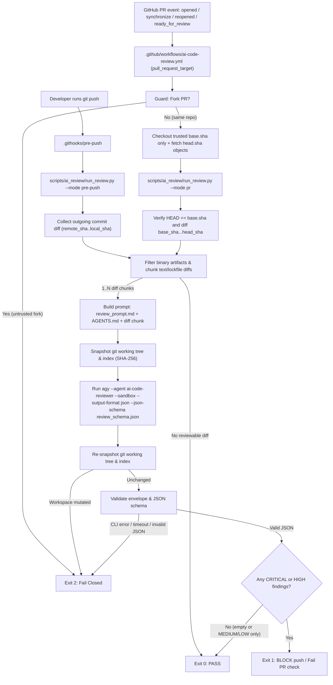

# AI Code Review System (`agy`)

This repository enforces automated, read-only AI code review powered by the **Antigravity CLI (`agy`)** using your Antigravity subscription (no Gemini API key or GCP service-account billing required):

1. **Local Git pre-push hook** (`.githooks/pre-push`) — reviews outgoing commits before `git push`.
2. **GitHub Actions Pull Request check** (`.github/workflows/ai-code-review.yml`) — reviews every PR creation and subsequent update (`opened`, `synchronize`, `reopened`, `ready_for_review`).

Both gates share the centralized rubric ([`scripts/ai_review/review_prompt.md`](../scripts/ai_review/review_prompt.md)), strict JSON schema ([`scripts/ai_review/review_schema.json`](../scripts/ai_review/review_schema.json)), read-only agent ([`.agents/agents/ai-code-reviewer.md`](../.agents/agents/ai-code-reviewer.md)), and Python 3 stdlib runner ([`scripts/ai_review/run_review.py`](../scripts/ai_review/run_review.py)).

---

## Policy & Exit Codes

| Exit Code | Outcome | Meaning |
| :---: | :--- | :--- |
| `0` | **PASS** | Valid structured response with zero `CRITICAL`/`HIGH` findings (or empty diff). `MEDIUM`/`LOW` items are advisory. |
| `1` | **BLOCK** | One or more `CRITICAL` or `HIGH` findings detected. Blocks `git push` and fails the `AI Code Review` PR check. |
| `2` | **FAIL CLOSED** | `agy` missing, unauthenticated, crashed, timed out, malformed JSON/schema, PR security violation, or workspace mutation detected. Never treated as PASS. |

---

## Security & Isolation Model

### 1. PR Tampering Prevention
- **Trusted workflow definition**: `.github/workflows/ai-code-review.yml` triggers on `pull_request_target`, so GitHub **always** executes the workflow YAML from the target base branch—PR commits cannot edit workflow steps, thresholds, or `runs-on`.
- **Trusted execution workspace**: The job checks out **only `base.sha`** (`clean: true`, `persist-credentials: false`), fetches `head.sha` solely as Git objects, and verifies `HEAD == base.sha` in `run_review.py`. PR code, PR `.agents/hooks.json`, or PR-modified reviewer scripts are **never** checked out or executed on the runner.
- **Protected-path audit + `CODEOWNERS`**: Any PR touching `.github/workflows/`, `.github/CODEOWNERS`, `scripts/ai_review/`, `.agents/`, or `.githooks/` is flagged for strict tamper auditing and gated by `.github/CODEOWNERS`.
- **Lockfiles included**: Dependency manifests and lockfiles (`package-lock.json`, `yarn.lock`, `pnpm-lock.yaml`, `poetry.lock`, `Cargo.lock`, `requirements*.txt`) are **never** excluded from analysis—they are chunked across hunks and audited for supply-chain risks. Only binary/generated build artifacts (`.tsbuildinfo`, images, `.apk`, `.db`, etc.) are skipped.

### 2. Isolated & Ephemeral Self-Hosted Runner Setup
Do **not** rely on GitHub-hosted `ubuntu-latest` cached OAuth credentials (there are none). Instead, run `AI Code Review` on an isolated, preferably **ephemeral** self-hosted runner signed into your Antigravity subscription:

1. Provision an isolated VM/container or dedicated unprivileged OS user with `agy` installed and authenticated once (`agy`). Do not store production deploy keys or unrelated secrets on this host.
2. Register the GitHub Actions runner in **Settings → Actions → Runners → New self-hosted runner** with label **`agy-reviewer`** and **ephemeral mode** (`--ephemeral`) so the runner resets cleanly after every job:
   ```bash
   ./config.sh --url https://github.com/A-fun-786/doctors-platform --token <TOKEN> --labels agy-reviewer --ephemeral
   ```
   *(A wrapper loop or VM snapshot/container supervisor restarts a fresh ephemeral runner after each job. The workflow also scrubs `$RUNNER_TEMP` and workspace state in an `always()` step.)*
3. **Fork PRs**: The workflow refuses untrusted fork PRs (`head.repo != repository`) before checkout so external PRs never touch your self-hosted runner.

---

## 3. Local Developer Setup

1. Ensure `agy` is installed and signed in interactively once (`agy`).
2. Activate the versioned pre-push hook:
   ```bash
   ./scripts/install-git-hooks.sh
   ```
3. Optional environment variables:
   - `AGY_MODEL` — override `agy`'s configured default model.
   - `AGY_REVIEW_TIMEOUT` — per-batch timeout in seconds (default: `180`).
   - `AGY_MAX_DIFF_CHARS` — per-batch diff size budget (default: `80000`).

---

## 4. Enabling Mandatory PR Merge Blocking on GitHub

1. Open **Settings → Branches → Branch protection rules** (or **Settings → Rules → Rulesets**) for `main` (and `develop`).
2. Enable **Require a pull request before merging** → **Require review from Code Owners** (protects `.github/workflows/`, `scripts/ai_review/`, `.agents/`, `.githooks/`).
3. Enable **Require status checks to pass before merging**, require branches to be up to date, and add **`AI Code Review`** as a required status check.

Or via GitHub CLI (`gh`):
```bash
gh api \
  --method PATCH \
  -H "Accept: application/vnd.github+json" \
  "/repos/A-fun-786/doctors-platform/branches/main/protection/required_status_checks" \
  -f strict=true \
  -f "contexts[]=AI Code Review"
```

---

## 5. Surfacing PR Review Findings Before Merging (AI Assistants & Humans)

Even if `AI Code Review` is **not** marked as a mandatory status check in GitHub branch rules:
- **Human reviewers** see the `<!-- agy-ai-code-review -->` comment directly on the PR conversation tab (with severity counts, `file:line`, explanation, and suggested fix) and can request changes or approve accordingly.
- **AI assistants** merging PRs (`gh pr merge`) must run:
  ```bash
  python3 scripts/ai_review/show_pr_review.py <pr-number>
  ```
  (enforced by [`AGENTS.md`](../AGENTS.md)) to fetch and report the latest `AI Code Review` check status and findings to the developer before merging.

---

## 1. End-to-End Architecture & Gates



---

## 6. Isolated Testing & Live Verification

- **Automated unit & git-hook suite** (runs inside disposable `/tmp` git repositories):
  ```bash
  python3 -m unittest discover -s scripts/ai_review -p "test_*.py" -v
  ```
- **Live `agy` testing**: Always test against a disposable `/tmp` git repository or an isolated staging/ephemeral runner—never against dirty developer working trees or production branches.
