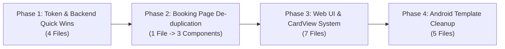

# 🏗️ Refactoring & Code De-duplication Implementation Plan

> **Document Version:** 1.0.0  
> **Target Codebase:** `doctors-platform` (Next.js Frontend, Android Compose Template, FastAPI Backend)  
> **Status:** Ready for Execution  

---

## 📊 1. Executive Summary & Total Count

Comprehensive codebase audit ke dauran humne **Frontend (Next.js)**, **Android App Template (Jetpack Compose)**, aur **Backend (FastAPI)** mein duplicate code, repetitive UI structures, monolithic files, hardcoded strings, aur unused token authentication files identify kiye hain.

### 🔢 Total Count Metrics

| Metric | Count | Details |
| :--- | :---: | :--- |
| **Total Files with Duplication / Flaws** | **17 Files** | 10 Frontend + 5 Android + 2 Backend |
| **Total Token-Handling Files** | **9 Files** | 4 Frontend + 5 Backend |
| **Dead / Orphaned Duplicate Files** | **1 File** | `components/auth/GoogleAuthForm.tsx` (271 lines of dead code) |
| **Monolithic Large Files Requiring Split** | **1 File** | `app/[slug]/page.tsx` (1,676 lines) |
| **Duplicate UI Card Implementations** | **9 Locations** | 5 Web components + 4 Android Compose cards |
| **Estimated Code Reduction** | **~1,200+ Lines** | Redundant form logic, dead code, aur inline CSS classes hatne ke baad |

---

## 🔍 2. Identified Flaws: "Kya Galti Hai?" (Detailed Root Causes)

Neeche 8 mukhya galtiyan aur unka detailed impact bataya gaya hai:

### ⚠️ Galti 1: Dead Code & Duplicate Token Authentication
* **Files:** `components/auth/GoogleAuthForm.tsx` (271 lines) vs `components/auth/EmailAuthForm.tsx` (322 lines)
* **Khamiyan:**
  * `GoogleAuthForm.tsx` kisi bhi page (`/login`, `/register`, etc.) par import ya use nahi ho rahi hai.
  * Google OAuth ID Token callback handling aur mock token generator (`mock-google-token:...`) dono files mein copy-paste hain.
  * Maintenance issue: Agar kal Google OAuth credentials ya flow change hota hai toh do alag-alag jagah update karna padega.

### ⚠️ Galti 2: Monolithic Public Booking Page (Extreme Repetition)
* **File:** `app/[slug]/page.tsx` (1,676 lines)
* **Khamiyan:**
  * **In-Clinic Booking** (Lines 880–1050) aur **Video Consultation Booking** (Lines 1120–1280) lagbhag **90% identical** hain.
  * Date picker input, 30-minute time slot selection grid (with `format12Hour`), patient inputs (Name, Phone, Problem/Symptoms), loader spinner, aur success dialog dono jagah duplicate likhe gaye hain.
  * File ki length 1600+ lines hone ki wajah se readability aur testing bohot mushkil ho gayi hai.

### ⚠️ Galti 3: Reusable `<Card>` Component Ka Na Hona
* **Files:** `OverviewTab.tsx`, `AndroidAppTab.tsx`, `ProfileTab.tsx`, `ProfileViewCard.tsx`, `WorkingHoursCard.tsx`
* **Khamiyan:**
  * UI library (`components/ui/`) mein `Badge.tsx`, `Modal.tsx`, `Toast.tsx` hain lekin standard `Card.tsx` nahi hai.
  * Har developer ne manual Tailwind classes repeat ki hain:
    `bg-white rounded-2xl border border-slate-200 shadow-xs p-4 sm:p-6 space-y-4`
  * Har tab mein alag rounded corners (`rounded-xl` vs `rounded-2xl`) aur shadows se UI inconsistencies paida hoti hain.

### ⚠️ Galti 4: Inconsistent Status Badges
* **Files:** `OverviewTab.tsx`, `DayView.tsx`, `WeekView.tsx`, `app/[slug]/page.tsx`
* **Khamiyan:**
  * Project mein `components/ui/Badge.tsx` exist karta hai, par developers ne status show karne ke liye inline conditional strings likh rakhi hain:
    ```tsx
    appt.status === "BOOKED" ? "bg-blue-50 text-blue-700 border-blue-200" : ...
    ```
  * Centralized status mapping na hone se naye status add karna error-prone hai.

### ⚠️ Galti 5: Calendar Views Mein Duplicate Event Parsing
* **Files:** `components/dashboard/calendar/views/DayView.tsx` & `WeekView.tsx`
* **Khamiyan:**
  * Dono views ke paas slot cell ke events nikalne ka same code block hai:
    ```tsx
    const apptEvent = cellEvents.find((ev) => ev.type === "APPOINTMENT");
    const leaveEvent = cellEvents.find((ev) => ev.type === "LEAVE" || ev.type === "HOLIDAY");
    const blockedEvent = cellEvents.find((ev) => ev.type === "BLOCKED");
    ```
  * Event tooltips aur title formatting string logic dono files mein duplicate hai.

### ⚠️ Galti 6: Android Jetpack Compose Card Scaffolding Copy-Paste
* **Files:** `AppointmentBookingCard.kt`, `LabDiagnosticsCard.kt`, `MedicineDeliveryCard.kt`, `VideoConsultationCard.kt`
* **Khamiyan:**
  * Chaaron cards ka UI skeleton exact copy hai:
    `Surface(shape = RoundedCornerShape(20.dp), shadow = 2.dp)` -> `Column` -> `Box(Brush.horizontalGradient)` -> `Row(Icon Box + Titles)`.
  * Sirf internal contents aur colors alag hain, scaffolding 100% duplicate hai.

### ⚠️ Galti 7: Android Hardcoded Strings
* **File:** `android-template/app/src/main/res/values/strings.xml`
* **Khamiyan:**
  * `strings.xml` mein sirf ek string (`app_name`) hai.
  * Sabhi buttons ("Confirm Booking", "Order Now", "Select Slot"), headings aur labels Kotlin files ke andar hardcoded strings hain. Multi-language (i18n) aur white-label branding ke liye yeh galat approach hai.

### ⚠️ Galti 8: Duplicate Backend Tenant Queries
* **Files:** `backend/app/api/routes/public.py` (Line 22) & `backend/app/api/routes/schedule.py` (Line 174)
* **Khamiyan:**
  * Dono routes mein exact same query block repeat ho raha hai:
    ```python
    tenant = db.query(Tenant).filter(Tenant.slug == slug.lower(), Tenant.status == "active").first()
    if not tenant or not tenant.doctor:
        raise HTTPException(status_code=404, detail="Doctor practice with link ... was not found.")
    ```

---

## 🗺️ 3. Phase-Wise Implementation Plan: "Kya Karna Hai?"

---

### 🔹 Phase 1: Token & Backend Quick Wins (No Breaking Changes) ✅ [COMPLETED]
* **Objective:** Dead code hatana, Token flow consolidate karna, aur backend queries ko clean karna.
* **Files Involved (4):**
  1. `components/auth/GoogleAuthForm.tsx`
  2. `components/auth/EmailAuthForm.tsx`
  3. `backend/app/api/routes/public.py`
  4. `backend/app/api/routes/schedule.py`

#### Detailed Action Items:
1. **GoogleAuthForm Safely Retire Karein:**
   - Verify karein ki koi active router `GoogleAuthForm` ko use nahi kar raha (`/login` aur `/register` dono `EmailAuthForm` use karte hain).
   - `GoogleAuthForm.tsx` ko safely delete ya archive karein. Isse 271 lines of dead duplicate code turant khatam ho jayega.
2. **Backend Tenant Dependency Extract Karein:**
   - `backend/app/api/deps.py` mein ek common helper dependency banayein:
     ```python
     def get_active_tenant_by_slug(slug: str, db: Session = Depends(get_db)) -> Tenant:
         tenant = db.query(Tenant).filter(Tenant.slug == slug.lower(), Tenant.status == "active").first()
         if not tenant or not tenant.doctor:
             raise HTTPException(status_code=status.HTTP_404_NOT_FOUND, detail=f"Doctor practice '{slug}' was not found.")
         return tenant
     ```
   - `public.py` aur `schedule.py` dono mein is dependency ko reuse karein.

* **Expected Outcome:** 271 lines dead code deleted, clean backend architecture, zero risk.
* **Execution Status:** ✅ **VERIFIED & COMPLETED** (See detailed log in [`refactoring_progress.md`](file:///d:/doctors-platform/refactoring_progress.md))
  - Backend Pytest: 153/153 Passed
  - Frontend Build & QA: 166/166 Passed
  - Live Server Integration: 62/62 Passed

---

### 🔹 Phase 2: Monolithic Booking Page De-duplication ✅ [COMPLETED]
* **Objective:** `app/[slug]/page.tsx` (1676 lines) ko modular subcomponents mein split karna aur 90% duplicate form logic khatam karna.
* **Files Involved (1 existing file + 3 new modular subcomponents):**
  1. `app/[slug]/page.tsx`
  2. *(New)* `components/public-booking/TimeSlotPicker.tsx`
  3. *(New)* `components/public-booking/AppointmentBookingForm.tsx`
  4. *(New)* `components/public-booking/BookingConfirmationCard.tsx`

#### Detailed Action Items:
1. **Shared `<TimeSlotPicker />` Extract Karein:**
   - Date selection, loading spinner (`Loader2`), empty state alert, aur slot chips grid ko ek isolated component mein move karein.
   - Props: `selectedDate`, `onDateChange`, `slots`, `loading`, `selectedSlot`, `onSelectSlot`.
2. **Unified `<AppointmentBookingForm />` Banayein:**
   - In-Clinic aur Video form ke liye ek shared component banayein with a `consultationType: "IN_CLINIC" | "VIDEO"` prop.
   - Patient info inputs (Name, Phone, Email, Symptoms) aur form submission logic ek hi component se run honge.
3. **Shared `<BookingConfirmationCard />` Banayein:**
   - Booking complete hone par aane wala success screen (reference ID, doctor details, "Return to Practice Home" button) extract karein.
4. **`app/[slug]/page.tsx` Ko Thin Controller Banana:**
   - Monolithic page ab sirf doctor metadata fetch karega aur clean components ko render karega.

* **Expected Outcome:** 632 lines eliminated from monolithic page. Zero duplicate slot/input UI.
* **Execution Status:** ✅ **VERIFIED & COMPLETED** (See detailed log in [`refactoring_progress.md`](file:///d:/doctors-platform/refactoring_progress.md))
  - Backend Pytest: 153/153 Passed
  - Frontend Build & QA: 166/166 Passed
  - Production Build: `next build` 8/8 routes passed clean

---

### 🔹 Phase 3: Web UI Component System & Shared CardView
* **Objective:** Shared `<Card>` aur `<StatusBadge>` implement karke pure dashboard se duplicate inline CSS khatam karna.
* **Files Involved (7):**
  1. *(New)* `components/ui/Card.tsx`
  2. *(New)* `components/ui/StatusBadge.tsx`
  3. `components/dashboard/OverviewTab.tsx`
  4. `components/dashboard/AndroidAppTab.tsx`
  5. `components/dashboard/ProfileTab.tsx` & `ProfileViewCard.tsx`
  6. `components/dashboard/calendar/sidebar/WorkingHoursCard.tsx`
  7. `components/dashboard/calendar/views/DayView.tsx` & `WeekView.tsx`

#### Detailed Action Items:
1. **`components/ui/Card.tsx` Create Karein:**
   - Reusable primitives banayein: `<Card>`, `<CardHeader>`, `<CardTitle>`, `<CardContent>`, `<CardFooter>`.
   - Consistent defaults: `bg-white rounded-2xl border border-slate-200 shadow-xs`.
2. **`components/ui/StatusBadge.tsx` Create Karein:**
   - Appointment aur Schedule status (`BOOKED`, `COMPLETED`, `CANCELLED`, `PENDING`, `LEAVE`) ke liye unified badge mapper banayein.
3. **Dashboard Tabs Refactor Karein:**
   - `OverviewTab.tsx` aur `AndroidAppTab.tsx` ke inline `div` cards ko `<Card>` aur `<StatusBadge>` se replace karein.
4. **Calendar Cell Resolution Logic Centralize Karein:**
   - `components/dashboard/calendar/calendarUtils.ts` mein `resolveCellEvents(cellEvents)` helper function add karein taaki DayView aur WeekView dono wahi se event type aur formatted tooltips derive karein.

* **Expected Outcome:** Consistent visual theme, centralized UI styling, duplicate utility logic eliminated.

---

### 🔹 Phase 4: Android App Template Modernization
* **Objective:** Jetpack Compose feature cards ka common scaffold banana aur strings ko `strings.xml` mein localize karna.
* **Files Involved (5):**
  1. *(New)* `android-template/app/src/main/kotlin/com/docspace/template/ui/components/DocSpaceCardScaffold.kt`
  2. `AppointmentBookingCard.kt`
  3. `LabDiagnosticsCard.kt`
  4. `MedicineDeliveryCard.kt`
  5. `VideoConsultationCard.kt`
  6. `android-template/app/src/main/res/values/strings.xml`

#### Detailed Action Items:
1. **`DocSpaceCardScaffold.kt` Composable Banayein:**
   - Common parameters: `title: String`, `subtitle: String`, `icon: ImageVector`, `gradientColors: List<Color>`, `content: @Composable () -> Unit`.
   - Card ki surface shape, shadow, aur gradient top bar ko ek hi jagah define karein.
2. **Existing 4 Cards Ko Migrate Karein:**
   - `AppointmentBookingCard`, `LabDiagnosticsCard`, `MedicineDeliveryCard`, `VideoConsultationCard` ab sirf apna specific business form `DocSpaceCardScaffold` ke content block mein pass karenge.
3. **Strings Centralize Karein:**
   - "Book In-Clinic Appointment", "Select Date & Time", "Confirm Booking", "Consultation Fee" jaisi hardcoded strings ko `strings.xml` mein move karein.

* **Expected Outcome:** Jetpack Compose code 40% concise ho jayega aur future white-label Android builds ke liye strings customizable hongi.

---

## 📈 4. Phase Execution & Verification Tracker



| Phase | Estimated Effort | Impact | Validation Test |
| :---: | :---: | :---: | :--- |
| **Phase 1** | ~30 mins | Clean Auth / Zero Dead Code | Run `npm run build` & Backend pytest |
| **Phase 2** | ~1-2 hours | High (Shrinks 1200+ lines) | Public booking end-to-end test (Clinic & Video) |
| **Phase 3** | ~1 hour | High (Visual Consistency) | Dashboard overview & calendar views check |
| **Phase 4** | ~45 mins | Medium (Android Architecture) | Android template syntax & preview check |

---

*This document is ready in `docs/REFACTORING_IMPLEMENTATION_PLAN.md` for tracking progress during implementation.*

