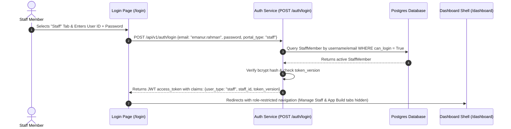

# Staff Management & Authentication Architecture

**Document Version:** 2.5.0  
**Status:** Production Ready  
**Target Platform:** GoSmartClinic Practice Management System  
**Last Updated:** November 20, 2026  

---

## 1. Overview

The **Staff Management & Authentication** system provides a multi-tenant, role-isolated operational hierarchy for healthcare clinics. It allows clinic owner doctors (Practice Administrators) to maintain a complete clinical and administrative roster, provision staff credentials without requiring employee email addresses, enforce strict login portal boundaries, and delegate day-to-day clinic operations without exposing administrative configurations.

### Where It Sits in the Architecture
- **Multi-Tenant Foundation:** All staff entities belong to a clinic owner (`doctors.id`), inheriting tenant configuration, working hours, and appointment pools.
- **Dual-Portal Entry Point (`/login`):** Segregated tabs for **Admin** (clinic owners via email or Google OAuth) and **Staff** (personnel via User ID and password).
- **Clinical Delegation:** Employed doctors can conduct consultations and complete visits under their own name while receptionists manage bookings and intake.
- **Practitioner Classification & Specialities:** Doctors require a mandatory `speciality` dropdown selection (e.g. Cardiologist, Dermatologist, General Physician), displayed dynamically across appointment booking and staff directory views.

---

## 2. Code Map

### Key Files & Classes

| File / Component | Responsibility |
| :--- | :--- |
| [`backend/app/models/staff.py`](file:///Users/emanur/doctors-platform/backend/app/models/staff.py) | Defines `StaffMember` entity with `username`, `token_version`, canonical `is_doctor_role` classifier, and `@property is_doctor`. |
| [`backend/app/schemas/staff.py`](file:///Users/emanur/doctors-platform/backend/app/schemas/staff.py) | Pydantic v2 schemas (`StaffMemberCreate`, `StaffMemberUpdate`) with `@field_validator` for User ID & phone. |
| [`backend/app/services/staff_service.py`](file:///Users/emanur/doctors-platform/backend/app/services/staff_service.py) | Candidate User ID generation, collision handling, credential rotation, and CRUD operations. |
| [`backend/app/services/auth_service.py`](file:///Users/emanur/doctors-platform/backend/app/services/auth_service.py) | Authenticates staff User IDs, verifies passwords, issues JWTs, and enforces portal boundaries. |
| [`backend/app/api/deps.py`](file:///Users/emanur/doctors-platform/backend/app/api/deps.py) | Injects tenant context, checks JWT `token_version`, and enforces `is_staff_doctor` restrictions. |
| [`backend/app/api/routes/staff.py`](file:///Users/emanur/doctors-platform/backend/app/api/routes/staff.py) | Endpoints for listing, creating, updating, resetting passwords, and removing staff members. |
| [`backend/app/api/routes/schedule.py`](file:///Users/emanur/doctors-platform/backend/app/api/routes/schedule.py) | Enforces `require_doctor_owner` on schedule entry creation, deletion, and working hours updates (returns 403 for staff). |
| [`components/auth/EmailAuthForm.tsx`](file:///Users/emanur/doctors-platform/components/auth/EmailAuthForm.tsx) | Dual-tab login UI with 1-click tab switching when accounts attempt the wrong portal. |
| [`components/dashboard/StaffTab.tsx`](file:///Users/emanur/doctors-platform/components/dashboard/StaffTab.tsx) | Executive minimalist roster UI, interactive KPI filter bar, 3-card forms, and beside-box password generator. |
| [`lib/api.ts`](file:///Users/emanur/doctors-platform/lib/api.ts) | Frontend client SDK types and methods for staff operations. |

### Entry Points & Authentication Flow



### Data Models & Important State

```sql
CREATE TABLE staff_members (
    id UUID PRIMARY KEY,
    doctor_id UUID NOT NULL REFERENCES doctors(id) ON DELETE CASCADE,
    full_name VARCHAR(120) NOT NULL,
    username VARCHAR(60) UNIQUE NULL,
    email VARCHAR(255) NULL,
    phone VARCHAR(30) NOT NULL,
    role VARCHAR(50) NOT NULL,
    department VARCHAR(50) NOT NULL DEFAULT 'Clinical',
    employment_type VARCHAR(30) NOT NULL DEFAULT 'full_time',
    status VARCHAR(30) NOT NULL DEFAULT 'active',
    joining_date DATE NOT NULL DEFAULT CURRENT_DATE,
    base_salary_paise INTEGER NOT NULL DEFAULT 0,
    emergency_contact VARCHAR(100) NULL,
    notes TEXT NULL,
    can_login BOOLEAN NOT NULL DEFAULT FALSE,
    hashed_password VARCHAR(255) NULL,
    must_change_password BOOLEAN NOT NULL DEFAULT TRUE,
    last_login_at TIMESTAMP WITH TIME ZONE NULL,
    token_version INTEGER NOT NULL DEFAULT 1,
    created_at TIMESTAMP WITH TIME ZONE NOT NULL DEFAULT NOW(),
    updated_at TIMESTAMP WITH TIME ZONE NOT NULL DEFAULT NOW()
);

CREATE UNIQUE INDEX idx_staff_username ON staff_members(username);
CREATE INDEX idx_staff_doctor_status ON staff_members(doctor_id, status);
CREATE INDEX idx_staff_doctor_dept ON staff_members(doctor_id, department);
CREATE INDEX idx_staff_email ON staff_members(email);
```

---

## 3. Decisions and Gotchas

### Why Staff User IDs Instead of Mandatory Emails
- **Clinic Reality:** Many nurses, receptionists, lab technicians, and shift assistants in clinics do not have distinct clinic email addresses.
- **Solution:** Automatic generation of professional, name-derived User IDs (`emanur.rahman`, `e.rahman`, `emanur.r`). Staff sign in with `@username` + password. Email is 100% optional.

### Candidate Sequence & Collision Resolution
When creating staff, `generate_username_candidates` tests candidates in batches of 50 in priority order:
1. `first.last` (e.g. `emanur.rahman`)
2. `f.last` (e.g. `e.rahman`)
3. `first.l` (e.g. `emanur.r`)
4. `firstlast` (e.g. `emanurrahman`)
5. `flast` (e.g. `erahman`)
6. `firstl` (e.g. `emanurr`)
7. Minimal numeric fallbacks: `e1.rahman`, `emanur.r1`, `e2.rahman`, `emanur.r2`...

### Immediate Session Invalidation (`token_version`)
- **Mechanism:** The JWT payload includes a `token_version` claim matching `staff_members.token_version`.
- **Revocation:** Whenever an administrator resets a password in [`reset_staff_password`](file:///Users/emanur/doctors-platform/backend/app/services/staff_service.py#L334) or updates credentials in [`update_staff`](file:///Users/emanur/doctors-platform/backend/app/services/staff_service.py#L280), `token_version` increments by 1.
- **Gotcha:** Any old JWT sent with a mismatched `token_version` is rejected with `HTTP 401 Unauthorized ("Credentials have changed. Please log in again.")`.

### Beside-Input Generate Button
- In Add Staff, Edit Staff, and Password Reset dialogs, the blue **Generate** button sits directly beside the password field in a uniform `h-10` flex row (`flex items-center gap-2`), avoiding awkward label-row text links.

### Canonical Practitioner Classification (`is_doctor_role` & `isDoctorRole`)
- **Vulnerability Solved:** Previous versions used ad-hoc role keyword lists and a fallback `or s.department == "Clinical"`. This caused non-doctor clinical staff (such as Nurses and Technicians) to be exposed as bookable doctors in `list_practitioners`, while medical specialists (such as `Cardiologist` and `Pediatrician`) bypassed staff doctor boundaries in `deps.py:is_staff_doctor` or were miscounted on the frontend.
- **Single Source of Truth:** `DOCTOR_ROLE_KEYWORDS`, `NON_DOCTOR_ROLE_KEYWORDS`, and `is_doctor_role(role)` in [`backend/app/models/staff.py`](file:///Users/emanur/doctors-platform/backend/app/models/staff.py) now classify practitioner boundaries consistently across `deps.py`, `appointment_service.py`, and `schedule_service.py`. Non-doctor staff targeted during booking/rescheduling fail immediately with `400 Bad Request`.
- **Frontend Parity:** [`lib/api.ts`](file:///Users/emanur/doctors-platform/lib/api.ts) exports an identical `isDoctorRole(role)` classifier used across [`StaffTab.tsx`](file:///Users/emanur/doctors-platform/components/dashboard/StaffTab.tsx) and [`CalendarTab.tsx`](file:///Users/emanur/doctors-platform/components/dashboard/CalendarTab.tsx), eliminating fragmented inline substring checks (`role.includes('doctor')`).
- **Availability Query Boundary (Issue #29):** When querying `GET /doctor/available-slots` or `/public/tenants/{slug}/available-slots` with a `staff_id`, the engine enforces Step 0 validation against the clinic's active doctor staff. Malformed UUID strings or non-doctor roles reject with `400 Bad Request`, foreign or nonexistent IDs reject with `404 Not Found`, and on-leave doctors return `[]`, eliminating phantom slot leaks and accidental fallbacks to clinic-wide multi-doctor capacity.
- **Primary Doctor Rescheduling Boundary (Issue #30):** When rescheduling an appointment attended by the primary doctor (`staff_id` is null or undefined), the UI passes `targetStaffId="primary"` to `SlotSelectorGrid` and `getDoctorAvailableSlots`. Omitting `staff_id` or passing `null` previously fell back to clinic-wide multi-doctor aggregate capacity, which hid valid primary slots when staff doctors were booked or exposed slots when the primary doctor was unavailable.
- **Reschedule Reason and Notes Persistence (Issue #32):** Rescheduling an appointment attended by either a staff doctor or the primary clinic doctor persists any updated visit reasons and clinical notes in the database without silent truncation.

### Zero Plain-Text Storage & Ephemeral Session Cache
- Passwords are one-way hashed with `bcrypt` (12 rounds) and never stored in plain text.
- To allow clinic owners to share initial credentials, the UI uses an in-memory session cache (`recentPasswords`) to display a temporary **Eye Reveal/Mask** toggle and **Copy Pass** button. Refreshing the browser permanently purges the plain text from memory.

---

## 4. How to Work With It

### Build, Run, and Test Commands

```bash
# Backend pytest suite (isolated memory DB):
ALLOW_MOCK_AUTH=true ./backend/.venv/bin/pytest backend/tests

# Run specific staff tests:
./backend/.venv/bin/pytest backend/tests/test_staff_auth.py backend/tests/test_staff.py -v

# Frontend type check & lint:
npx tsc --noEmit && npm run lint

# Frontend test suites (responsive QA & functional):
npm test

# Production build:
npm run build
```

### Adding a Staff Member via API

```bash
curl -X POST http://localhost:8000/api/v1/staff \
  -H "Authorization: Bearer <ADMIN_JWT>" \
  -H "Content-Type: application/json" \
  -d '{
    "full_name": "Dr. Priya Sen",
    "phone": "+91 98765 43210",
    "role": "Doctor",
    "department": "Clinical",
    "employment_type": "full_time",
    "base_salary_paise": 7500000,
    "can_login": true,
    "password": "Clinic@Temp123!"
  }'
```

---

## 5. Agent-Facing Notes (Rules & Invariants)

- **Do NOT allow staff doctors to book, cancel, or reschedule:**
  - Backend must return `403 Forbidden` (`is_staff_doctor(current_doctor)`).
  - UI must hide booking buttons and action menus (`isStaffDoctor`).
- **Do NOT allow non-doctor staff to complete appointments:**
  - Backend must return `403 Forbidden` (`Non-doctor staff members are not permitted to complete appointments.`).
  - UI must hide the "Mark Completed" button for non-doctor staff (`canComplete = false`).
- **Staff Roster Data Isolation:**
  - Sensitive compensation (`base_salary_paise`), emergency contacts, and administrative notes are masked to `None` for all non-owner staff accounts calling `GET /api/v1/staff` and `GET /api/v1/staff/{id}`. Only clinic owners can inspect compensation and private notes.
- **Do NOT hard delete staff members with existing appointments:**
  - `delete_staff` checks for active (`BOOKED`) and completed (`COMPLETED`) appointments and rejects deletion with `400 Bad Request`. Personnel with medical history must be deactivated (`status = 'inactive'`) to preserve audit trails.
- **Do NOT allow staff members to mutate schedules or working hours:**
  - Schedule creations, deletions, and working-hours updates on `/doctor/schedule` and `/doctor/working-hours` require `require_doctor_owner` and return `403 Forbidden` for all staff members (receptionists and staff doctors).
- **Do NOT require email for staff logins:**
  - Staff authenticate via User ID (`username`) + password.
- **Keep Agenda Table strictly locked in width:**
  - Enforce `overflow-x-hidden` and `table-fixed w-full`. All columns must fit 100% of viewport without horizontal scrollbar.
- **Preserve CalendarSidebar mounting:**
  - Keep `<CalendarSidebar>` in `CalendarTab.tsx` (using `<div className="hidden" aria-hidden="true">` wrapper) to preserve automated test assertions.
- **Maintain Multi-Doctor Partial Indexes:**
  - Never use a single unique index across nullable `staff_id`; preserve `uq_primary_doctor_active_slot` and `uq_staff_doctor_active_slot`.
- **Canonical Practitioner Classification:**
  - Always use `is_doctor_role(role)` from [`backend/app/models/staff.py`](file:///Users/emanur/doctors-platform/backend/app/models/staff.py) for practitioner identification. Never infer doctor status from `department == "Clinical"`.

---

## 6. Open Questions / Known Tech Debt

1. **Shift Schedules per Staff Doctor:** Staff members currently inherit the clinic's primary working hours. Dedicated shift calendars per doctor are planned for a subsequent phase.
2. **Global Unique Index on User ID:** User IDs are currently globally unique. As the platform scales to tens of thousands of clinics, tenant-scoped User IDs (`username@clinic-slug`) can replace the global index.
