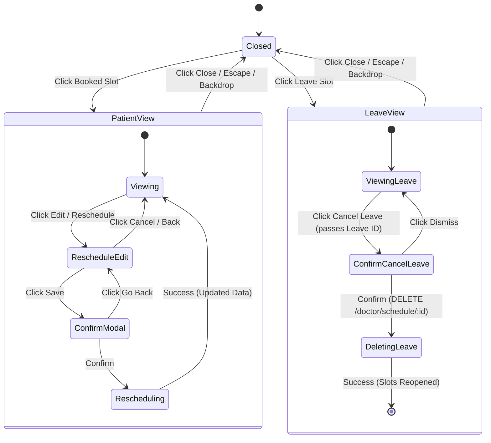

# Calendar Slot Details & Rescheduling Right-Side Drawer: UI/UX Implementation Plan

## Executive Summary
This document provides the complete architectural and UI/UX implementation plan for replacing the legacy centered event dialog in the Doctor Dashboard (`CalendarTab`) with a **modern, responsive right-side slide-over panel (drawer)**. 

When a doctor clicks an appointment or leave slot in the calendar, the panel glides in from the right without navigating away, keeping the calendar context visible on desktop and tablet. The experience provides:
1. **Patient Appointment Slot Details View**: A structured clinical dossier displaying all patient demographics, vitals, booking metadata, and visit history.
2. **In-Place Appointment Rescheduling**: Seamless transition into an edit mode with interactive date/slot pickers, conflict prevention, doctor working-hours guardrails, and a confirmation safety flow.
3. **Doctor Leave Management with Explicit Leave ID**: Dedicated leave details panel with prominent **Leave ID** display, doctor identity, exclusion timespan, reason, status, and an isolated, safe leave cancellation workflow that recalculates availability without impacting patient bookings.

---

## 1. Architectural Blueprint & Component Hierarchy

### Component Tree
```text
components/dashboard/
├── CalendarTab.tsx                     (Integrates drawer hook & renders CalendarDrawer)
└── calendar/
    ├── panels/                         [NEW DIRECTORY]
    │   ├── CalendarDrawer.tsx          (Slide-over container, backdrop, escape/outside click, sticky header)
    │   ├── AppointmentDetailsPanel.tsx (View mode: Patient dossier + Clinical specs + Action buttons)
    │   ├── AppointmentRescheduleForm.tsx (Edit mode: Date picker + 30m slot selector + notes + confirm)
    │   ├── LeaveDetailsPanel.tsx       (Leave ID banner + Leave specs + cancellation confirmation modal)
    │   ├── RescheduleConfirmModal.tsx  (Modal to confirm slot move)
    │   └── SlotSelectorGrid.tsx        (Interactive 30-min pill selector with status indicators)
    ├── hooks/
    │   ├── useCalendarData.ts          (Calendar event stream & week navigation)
    │   ├── useCalendarModals.ts        (Booking & block creation modals)
    │   └── useCalendarDrawer.ts        [NEW HOOK] (Drawer state, view/edit mode, active appointment/leave)
    └── types.ts                        (Extended interfaces for Drawer state, Slot selection, Vitals, Leave specs)
```

---

## 2. Detailed UI/UX Specifications

### 2.1 The Container: `CalendarDrawer`
- **Slide-in Animation**: Tailwind `transition-transform duration-300 ease-out transform translate-x-0` (slides from right `translate-x-full`).
- **Backdrop**: `fixed inset-0 z-40 bg-slate-900/25 backdrop-blur-[2px] transition-opacity` with desktop click-outside support.
- **Drawer Frame**: `fixed right-0 top-0 bottom-0 z-50 bg-white border-l border-slate-200 shadow-2xl flex flex-col`.
- **Dimensions**:
  - **Desktop (`xl:`, `2xl:`)**: `w-[480px] max-w-lg` (leaves calendar unobstructed).
  - **Tablet (`md:`, `lg:`)**: `w-[420px]` or `45vw`.
  - **Mobile (`<768px`)**: `w-full` full-screen drawer with safe-area padding.
- **Header**:
  - Sticky at top (`sticky top-0 bg-white/95 backdrop-blur-sm border-b border-slate-100 z-10 px-6 py-4`).
  - Left: Category badge (e.g. `Patient Appointment` in blue, `Doctor Leave` in amber) + prominent Title.
  - Right: Accessible Close button (`<button aria-label="Close panel">` with `X` icon, hover background).

---

### 2.2 Patient Appointment Slot — View Mode

#### A. Patient Identity Card (Top Section)
- **Avatar & Name**: Circular avatar with initials or profile icon, bold patient full name (`text-lg font-bold text-slate-900`).
- **Patient Identifier**: `Patient ID: PAT-xxxx` badge with a 1-click copy button.
- **Quick Contact Strip**:
  - Phone Number (`lucide-react/Phone`, formatted, with `tel:` link and copy action).
  - Email Address (`lucide-react/Mail`, with `mailto:` link).
  - Address (`lucide-react/MapPin`, multi-line readable text).
  *(Cleanly omitted if empty or not provided)*.

#### B. Patient Vitals & Demographics Matrix
- Displayed in a 4-column compact grid with soft slate cards:
  | Metric | Value Example | Icon |
  | :--- | :--- | :--- |
  | **Age** | `32 yrs` | `Calendar` |
  | **Gender** | `Female` | `User` |
  | **Blood Group** | `O+` (Badge) | `HeartPulse` |
  | **Weight** | `68 kg` | `Activity` |
- Only non-null vitals are rendered; empty slots cleanly reflow.

#### C. Appointment Metadata Card
- **Status Pill**: `BOOKED` (blue), `COMPLETED` (emerald), `CANCELLED` (rose).
- **Date & Window**: Formatted date (e.g. `Monday, Oct 19, 2026`) and 12-hour time (`10:00 AM – 10:30 AM`).
- **Identifiers**:
  - Appointment ID (`UUID`, with copy icon).
  - Doctor ID (`UUID` or doctor code).
  - Booking Created Date (formatted e.g. `Oct 18, 2026, 04:30 PM`).

#### D. Clinical Notes & Visit Reason
- **Visit Reason**: Primary badge (e.g. `Follow-up Consultation`, `Chest Pain Review`).
- **Doctor / Booking Notes**: Soft slate container with monospace or readable serif formatting.

#### E. Action Footer (Sticky Bottom)
- **Primary Action**: `Edit / Reschedule Appointment` (`bg-blue-600 hover:bg-blue-700 text-white rounded-xl py-2.5 px-4 font-semibold flex items-center justify-center gap-2 shadow-xs`).
- **Secondary Action**: `Close` button (`bg-slate-100 hover:bg-slate-200 text-slate-700 rounded-xl py-2.5 px-4`).

---

### 2.3 Reschedule Appointment — Edit Mode

When the doctor clicks `Edit / Reschedule Appointment`, the panel transitions smoothly into form mode:

#### A. Form Header & Context Banner
- Header switches to `Reschedule Appointment` with a `Back to Details` button (`ArrowLeft` icon).
- Current slot banner: `Currently booked for: Monday, Oct 19, 2026 at 10:00 AM – 10:30 AM`.

#### B. Date Picker & Day Selector
- Interactive native date picker or week day quick-chips (`Today`, `Tomorrow`, `Next Weekday`).
- Minimum date constrained to today (`min={today}`).

#### C. Available Time Slot Picker (`SlotSelectorGrid`)
- Real-time slot generator fetching from `getDoctorAvailableSlots(newDate)`.
- Slices available hours into 30-minute interactive pills.
- Visual status indicators:
  - **Available**: `bg-blue-50 text-blue-700 border-blue-200 hover:bg-blue-100` (clickable).
  - **Selected**: `bg-blue-600 text-white border-blue-600 shadow-sm` (active selection).
  - **Occupied / Conflicting**: `bg-slate-100 text-slate-400 border-slate-200 cursor-not-allowed` (disabled with tooltip: *"Booked"* or *"Doctor on Leave"*).
  - **Outside Working Hours**: Hidden or disabled with label *"Outside shift"*.

#### D. Clinical Reason & Notes
- Pre-filled `Visit Reason` dropdown or free-text input with quick-reason pills.
- Pre-filled `Additional Notes` textarea.

#### E. Confirmation Safety Dialog (`RescheduleConfirmModal`)
- Triggered on clicking `Save Rescheduled Time`.
- Displays side-by-side comparison:
  ```text
  Original Time:  Oct 19, 2026 • 10:00 AM – 10:30 AM
  New Time:       Oct 22, 2026 • 04:30 PM – 05:00 PM
  ```
- Warns that the previous slot will be immediately freed for other bookings.
- Actions: `Confirm & Reschedule` (blue) and `Cancel` (ghost).

#### F. Execution & State Transitions
1. **Submit**: Calls `rescheduleAppointment(appointmentId, { date, start_time, end_time })`.
2. **Calendar Invalidation**: Calls `refreshCurrentWeek()` to update week grid, day view, and sidebar mini-calendar.
3. **Notification**: Displays green success toast: `Appointment successfully rescheduled to [New Date] at [New Time]`.
4. **View Refresh**: Panel switches back to View Mode with updated appointment details.

---

### 2.4 Doctor Leave Slot — View and Cancel Leave Panel (Updated per Review)

When the doctor clicks an amber leave slot, a specialized leave management drawer opens displaying all 7 required core attributes:

```text
+-------------------------------------------------------------+
|  [COFFEE ICON]  DOCTOR LEAVE DETAILS                [CLOSE] |
|  Leave ID: LEV-8f3a9e21-4d2b-4a81-b512-32b0...     [COPY]   |
+-------------------------------------------------------------+
|  [LEAVE STATUS BADGE: SCHEDULED LEAVE / ACTIVE EXCLUSION]   |
|                                                             |
|  DOCTOR ID:  DOC-74a91b82-99c0-43e1-92fa...        [COPY]   |
|  LEAVE DATE: Monday, October 19, 2026                       |
|  TIME SPAN:  10:00 AM – 01:00 PM (3 Hours)                  |
|                                                             |
|  LEAVE REASON:                                              |
|  "Medical Conference / CME Keynote Presentation"            |
|                                                             |
|  +-------------------------------------------------------+  |
|  | [INFO] AVAILABILITY REOPENING NOTICE                  |  |
|  | Cancelling this leave will immediately recalculate    |  |
|  | and restore patient booking slots according to your   |  |
|  | working hours. Existing patient bookings are safe.    |  |
|  +-------------------------------------------------------+  |
|                                                             |
|  [CANCEL LEAVE / REOPEN SLOTS]                   [CLOSE]    |
+-------------------------------------------------------------+
```

#### A. Required Core Attributes & Display Hierarchy
1. **Leave ID (`schedule_id`)**:
   - Prominently rendered at the top in a distinct monospace tag (`bg-amber-100 text-amber-900 border border-amber-300 font-mono text-xs px-2.5 py-1 rounded-lg`).
   - Equipped with a 1-click **Copy ID** button and checkmark feedback tooltip.
   - **Backend Data Source**: Loaded directly from `event.schedule_id` (the UUID from the `schedules` database table) with fallback lookup to `getDoctorSchedule` for matching slot times. Never hardcoded.
2. **Doctor ID (`doctor_id`)**:
   - Monospace identifier displaying the authenticated doctor's reference ID with copy action.
3. **Leave Reason**:
   - Highlighted reason card (e.g. *"Attending National Medical Conference"*, *"Personal Leave"*).
4. **Leave Date**:
   - Full human-readable date format (e.g. `Monday, October 19, 2026`).
5. **Start Time and End Time**:
   - 12-hour formatted interval (e.g. `10:00 AM – 01:00 PM`) and total duration indicator (e.g. `3 Hours`).
6. **Leave Status**:
   - Prominent badge: `SCHEDULED LEAVE` or `ACTIVE EXCLUSION` (amber) / `CLINIC HOLIDAY` (rose).
7. **Strict Context Isolation**:
   - Absolutely **no patient rescheduling controls or patient dossier fields** are displayed in the leave panel.

#### B. Safety & Availability Reassurance Card
- Clear clinical guidance banner:
  > *"Cancelling this leave will immediately reopen available 30-minute booking slots for your patients according to your active working hours. Existing patient appointments are never deleted or affected."*

#### C. Destructive Action: Cancel Leave Workflow
1. **Action Trigger**:
   - High-visibility destructive button: `Cancel Leave / Reopen Slots` (`bg-rose-50 hover:bg-rose-100 text-rose-700 border border-rose-200 py-2.5 px-4 rounded-xl font-semibold flex items-center justify-center gap-2`).
2. **Confirmation Safety Modal**:
   - Displays modal dialog:
     - Title: `Confirm Leave Cancellation`
     - Body: `Are you sure you want to cancel Leave ID: [Leave ID] on [Date] from [Start Time] to [End Time]? Reopened slots will become available for patient booking.`
     - Actions: `Confirm & Cancel Leave` (rose) vs `Keep Leave` (slate outline).
3. **Backend Execution**:
   - Sends `DELETE /api/v1/doctor/schedule/{leave_id}` via `deleteDoctorSchedule(leaveId)`.
4. **Post-Cancellation Flow**:
   - Live calendar recalculation: Calls `refreshCurrentWeek()` to regenerate slots and unblock the calendar.
   - Shows feedback toast: `Leave cancelled. Slots successfully reopened for patient booking.`
   - Automatically closes the drawer.

---

## 3. Responsive Breakpoints & Viewport Behavior

| Viewport | Drawer Width | Calendar Behind Drawer | Header & Footer | Interaction |
| :--- | :--- | :--- | :--- | :--- |
| **Desktop (`≥ 1280px`)** | `480px` fixed | Fully visible on the left; user can inspect week grid while reading details | Sticky top header, sticky bottom action bar | Escape key or backdrop click closes drawer |
| **Tablet (`768px – 1279px`)** | `420px` or `45vw` | Partially visible with soft blur backdrop | Sticky header & footer with auto-scroll body | Touch swipe or close icon |
| **Mobile (`< 768px`)** | `100vw` (full screen) | Hidden behind full drawer | Compact mobile header with safe-area spacing | Full-screen scrollable form; bottom fixed buttons |

---

## 4. State Management Architecture (`useCalendarDrawer`)



### Hook State Definition:
```typescript
interface CalendarDrawerState {
  isOpen: boolean;
  type: "appointment" | "leave" | null;
  mode: "view" | "edit"; // For appointment
  event: CalendarEvent | null;
  date: string;
  leaveId?: string; // Explicit Leave ID from backend Schedule record
  loading: boolean;
  error: string | null;
}
```

---

## 5. Security, Validation & Edge Cases

| Scenario | Behavior / Guardrail |
| :--- | :--- |
| **Missing Leave ID in legacy stream** | If `event.schedule_id` is temporarily missing, drawer performs immediate fallback query to `getDoctorSchedule` for matching date & interval to retrieve the real `Schedule.id`. Never stubs data. |
| **Cross-Doctor Protection** | Backend verifies `schedule.doctor_id == current_doctor.id` and `appointment.doctor_id == current_doctor.id`. 403/404 handled with friendly error state. |
| **Occupied Slot Reschedule** | Slot selector disables taken slots. If race condition occurs, backend returns `409 Conflict`; form displays inline alert with unsaved data intact. |
| **Overlapping Leave** | Slot generator filters out any slot hitting `LEAVE`, `HOLIDAY`, or `BLOCKED` schedules. |
| **Past Slot Selection** | Slots earlier than current time for today's date are disabled. |
| **Missing Optional Vitals** | Patient dossier conditionally renders fields. If email, weight, or notes are absent, section collapses cleanly without blank spaces or `"null"`. |
| **Network Error on Reschedule** | Form remains open with user-entered values preserved; retry button displayed. |
| **Leave Cancellation Safety** | Only deletes the schedule exclusion row (`DELETE /doctor/schedule/:id`); appointments table is untouched. |

---

## 6. Implementation Phases & Testing Checklist

### Phase 1: Foundation & Shared Drawer Shell
- [x] Add `schedule_id`, `doctor_id`, `patient_id`, `created_at` to `backend/app/schemas/calendar.py`.
- [ ] Create `components/dashboard/calendar/panels/CalendarDrawer.tsx` with Tailwind slide-in animation, backdrop, escape handler, and responsive widths.
- [ ] Implement `components/dashboard/calendar/hooks/useCalendarDrawer.ts` to manage drawer open/close, active event, Leave ID resolution, and view/edit modes.
- [ ] Update `components/dashboard/CalendarTab.tsx` to mount the drawer instead of the legacy `EventDetailsModal`.

### Phase 2: Patient Appointment Details View Mode
- [ ] Build `AppointmentDetailsPanel.tsx` with Patient Dossier Card, Vitals Matrix, Clinical Notes, and Appointment Metadata.
- [ ] Integrate background fetch for full appointment details (`getAppointment(id)`) to hydrate created dates and UUIDs.
- [ ] Add copy-to-clipboard buttons for IDs and contact details.

### Phase 3: In-Place Appointment Reschedule
- [ ] Build `AppointmentRescheduleForm.tsx` with date picker, quick reason pills, and note editing.
- [ ] Build `SlotSelectorGrid.tsx` to query `getDoctorAvailableSlots(date)` and render clickable 30-min chips.
- [ ] Implement `RescheduleConfirmModal.tsx` for before-save confirmation.
- [ ] Wire up `rescheduleAppointment()` API call with optimistic feedback and calendar reload (`refreshCurrentWeek()`).

### Phase 4: Doctor Leave View & Cancellation Panel
- [ ] Build `LeaveDetailsPanel.tsx` displaying **Leave ID**, Doctor ID, leave reason, formatted date, time span, status, and safety disclaimer.
- [ ] Implement cancellation confirmation modal displaying targeted Leave ID.
- [ ] Wire up `deleteDoctorSchedule(leaveId)` API call, reload calendar availability, and display feedback toast.

### Phase 5: Responsive Polish & Accessibility
- [ ] Audit on Mobile (375px), Tablet (768px), and Desktop (1440px).
- [ ] Verify keyboard tab navigation, `aria-modal`, and focus trapping.
- [ ] Verify light/dark theme contrast and healthcare SaaS aesthetic.

### Phase 6: Automated Verification & Test Suite
- [ ] Verify TypeScript compilation (`npx tsc --noEmit`).
- [ ] Verify Next.js ESLint (`npm run lint`).
- [ ] Execute automated appointment tests (`npm run test` or verification scripts).
