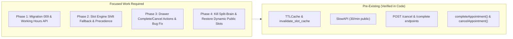

# Concise Implementation Plan: Doctor Appointment System

**Context:** [`docs/feature/appointment/`](file:///Users/mdaffanahmed/VS%20Code/Full%20stack/Doctors%20Platform/docs/feature/appointment) | **Target Branch:** `calendar-ui`  
**Guiding Architecture:** Production stack verified in [`docs/productionization_progress.md`](file:///Users/mdaffanahmed/VS%20Code/Full%20stack/Doctors%20Platform/docs/productionization_progress.md). Infrastructure (TTLCache, SlowAPI, structlog, Sentry, pool tuning, tenacity retries, CI/CD) is **already verified in code** and preserved as-is.

---

## 1. Scope & Verified Baseline



- **Already Implemented:**
  - `cachetools.TTLCache` (60s slots, 300s idempotency) and `invalidate_slot_cache()` in `backend/app/core/cache.py`.
  - Rate limiting with `RATE_LIMIT_SCHEDULE="30/minute"` on `GET /public/tenants/{slug}/available-slots` in `schedule.py:155`.
  - Backend lifecycle endpoints `POST /doctor/appointments/{id}/complete` and `POST /doctor/appointments/{id}/cancel` in `appointment_service.py:192-244` and `routes/appointment.py`.
  - Frontend client functions `completeAppointment()` and `cancelAppointment()` in `lib/api.ts:706,716`.
  - Database pool tuning, tenacity retries, structlog request ID tracing, and Sentry APM in `main.py` and `database.py`.

---

## 2. Phase-by-Phase Plan

### Phase 1: Doctor Working Hours Backend Persistence

**Deliverables:**
1. **Alembic Migration `009_add_working_hours_to_doctor.py`:**
   - Adds nullable `working_hours` JSON column to `doctors` table using `op.batch_alter_table` (`render_as_batch=True`).
   - No migration seeding (clean nullable column; defaults handled at application level).
2. **Model & Schemas:**
   - [`backend/app/models/doctor.py`](file:///Users/mdaffanahmed/VS%20Code/Full%20stack/Doctors%20Platform/backend/app/models/doctor.py): Add `working_hours: Mapped[Optional[dict]] = mapped_column(JSON, nullable=True)`.
   - [`backend/app/schemas/schedule.py`](file:///Users/mdaffanahmed/VS%20Code/Full%20stack/Doctors%20Platform/backend/app/schemas/schedule.py):
     - `WorkingHoursShift`: `id: str`, `label: str`, `start: str`, `end: str`, `enabled: bool` with `start < end` validation (`HH:MM`).
     - `DoctorWorkingHoursUpdate`: `shifts: List[WorkingHoursShift]`, `closed_days: List[int]` (ISO convention: Monday=0 ... Sunday=6).
     - `DoctorWorkingHoursResponse`: Returns saved JSON, or if null, single code-level default (Morning: 10:00–13:00, Evening: 16:00–20:00, `closed_days=[6]`).
3. **Endpoints in `backend/app/api/routes/schedule.py`:**
   - `GET /api/v1/doctor/working-hours`: Returns `DoctorWorkingHoursResponse`.
   - `PUT /api/v1/doctor/working-hours`: Decorated with `@limiter.limit(settings.RATE_LIMIT_SCHEDULE)`. Updates `doctor.working_hours`, calls existing `invalidate_slot_cache(current_doctor.id)`, and returns updated config.

---

### Phase 2: Slot Generation & Booking Validation Harmonization

**Deliverables:**
1. **Update `generate_available_slots` in [`schedule_service.py`](file:///Users/mdaffanahmed/VS%20Code/Full%20stack/Doctors%20Platform/backend/app/services/schedule_service.py):**
   - **Precedence Rule:** Query `Schedule(type="AVAILABLE")` for `query_date`. If per-date records exist, slice them (preserves test overrides).
   - **Shift Fallback:** If no `AVAILABLE` records exist, query `doctor.working_hours` (falling back to `DEFAULT_DOCTOR_WORKING_HOURS` if `None`).
     - Evaluate `query_date.weekday()` against `closed_days`. If closed, candidate slots = 0.
     - Slices active shifts into 30m slots ($[t, t+30\text{m})$).
   - **Past-Slot Guard:** If `query_date == date.today()`, filter out candidate intervals where `end_time <= datetime.now().time()`.
   - **Exclusions:** Subtract `LEAVE`, `HOLIDAY`, `BLOCKED`, and active `BOOKED`/`COMPLETED` appointments.

2. **Harmonize `_validate_slot_against_schedule` in [`appointment_service.py`](file:///Users/mdaffanahmed/VS%20Code/Full%20stack/Doctors%20Platform/backend/app/services/appointment_service.py):**
   - **Eliminate Separate Availability Requirement:** Remove the hard block requiring `Schedule.type == "AVAILABLE"`.
   - **Working Hours Validation:** If no explicit `AVAILABLE` entries exist for `slot_date`:
     - Validate that `slot_date` is not in `closed_days`. If closed, raise `HTTP 400: Clinic is closed on this date`.
     - Validate that `[start_time, end_time)` falls within an enabled shift in `doctor.working_hours` (or `DEFAULT_DOCTOR_WORKING_HOURS`). If not, raise `HTTP 400: Slot does not fall within doctor working hours`.
   - **Exclusions:** Check that `[start_time, end_time)` does not overlap any `LEAVE`, `HOLIDAY`, or `BLOCKED` entry. If `LEAVE` overlaps, raise `HTTP 400: Slot overlaps with LEAVE period`.
   - **Rescheduling Parity:** Ensure `reschedule_appointment` benefits identically from working hours slot validation.

---

### Phase 3: Appointment Lifecycle in Calendar Drawer

**Deliverables:**
1. **Wire Existing Helpers in [`AppointmentDetailsPanel.tsx`](file:///Users/mdaffanahmed/VS%20Code/Full%20stack/Doctors%20Platform/components/dashboard/calendar/panels/AppointmentDetailsPanel.tsx):**
   - Add **"Mark Completed"** action button (`CheckCircle` icon, emerald badge) calling existing `completeAppointment(appointment_id)`.
   - Add **"Cancel Appointment"** action button (`XCircle` icon, rose outline) opening a confirmation dialog:
     - Clear warning: *"Cancelling this appointment will release this 30-minute slot for other patients."*
     - Confirm button dispatches existing `cancelAppointment(appointment_id, reason)`.
   - On completion/cancellation: `await ... -> onRefreshCalendar() -> showToast()`.
2. **Fix Status Guard Bug:**
   - [`AppointmentDetailsPanel.tsx:464`](file:///Users/mdaffanahmed/VS%20Code/Full%20stack/Doctors%20Platform/components/dashboard/calendar/panels/AppointmentDetailsPanel.tsx#L464): Update guard from `currentEvent.status !== "CANCELLED"` to:
     ```tsx
     currentEvent.status !== "CANCELLED" && currentEvent.status !== "COMPLETED"
     ```
     Prevents completed consultations from being rescheduled.
3. **Status Badges:** Color-code `BOOKED` (blue), `COMPLETED` (emerald), `CANCELLED` (rose), `NO_SHOW` (slate).

---

### Phase 4: Public Dynamic Slots & Kill Split-Brain

**Deliverables:**
1. **Kill Split-Brain Working Hours:**
   - Add `getDoctorWorkingHours()` and `updateDoctorWorkingHours()` to [`lib/api.ts`](file:///Users/mdaffanahmed/VS%20Code/Full%20stack/Doctors%20Platform/lib/api.ts).
   - In [`CalendarTab.tsx`](file:///Users/mdaffanahmed/VS%20Code/Full%20stack/Doctors%20Platform/components/dashboard/CalendarTab.tsx) on mount: Fetch working hours from backend API, seeding state and updating `localStorage` as offline cache.
   - In [`EditWorkingHoursModal.tsx`](file:///Users/mdaffanahmed/VS%20Code/Full%20stack/Doctors%20Platform/components/dashboard/calendar/modals/EditWorkingHoursModal.tsx): On save, dispatch `updateDoctorWorkingHours()` to the backend AND update `localStorage`.
2. **Restore Dynamic Slots in [`app/[slug]/page.tsx`](file:///Users/mdaffanahmed/VS%20Code/Full%20stack/Doctors%20Platform/app/%5Bslug%5D/page.tsx):**
   - Remove hardcoded `TIME_SLOTS` array.
   - Call existing `getPublicAvailableSlots(slug, selectedDate)` on date change for In-Clinic and Video forms.
   - Add loading spinner (`Loader2`) and courteous empty state (*"No available slots on this date. Please choose another date."*).

---

### Phase 5: Focused Verification

**Deliverables:**
1. **5 Backend Pytest Cases (`backend/tests/test_working_hours_engine.py`):**
   - `test_1_get_working_hours_default_fallback`: Returns standard shifts when column is null.
   - `test_2_put_working_hours_valid_and_validation_error`: Validates `start < end` and persists.
   - `test_3_slot_generation_from_shifts_and_closed_day`: Asserts 14 slots on weekdays, 0 on Sunday (`closed_days=[6]`).
   - `test_4_precedence_explicit_available_wins`: Per-date `AVAILABLE` records override shifts.
   - `test_5_migration_009_upgrade_downgrade`: Verifies bidirectional rollback clean.
2. **Frontend AST Verification Script (`scripts/verify_appointment_ui_integration.mjs`):**
   - V1: `AppointmentDetailsPanel` exposes Complete and Cancel buttons calling `completeAppointment` / `cancelAppointment`.
   - V2: `AppointmentDetailsPanel` hides Edit button when `status === "COMPLETED"` or `"CANCELLED"`.
   - V3: `app/[slug]/page.tsx` calls `getPublicAvailableSlots`.
   - V4: `EditWorkingHoursModal` dispatches backend API call.
3. **CI Pipeline:** Rely on existing `.github/workflows/ci.yml` for `tsc`, `lint`, and `build`.

---

## 3. Execution Sequence

```text
Phase 1: Migration 009 + Working Hours GET/PUT routes
    ↓
Phase 2: Slot engine fallback + closed_days + past-slot guard
    ↓
Phase 3: Drawer Complete/Cancel buttons + edit guard fix
    ↓
Phase 4: Kill split-brain in UI + restore dynamic public slots
    ↓
Phase 5: 5 Pytest tests + AST script check
```
