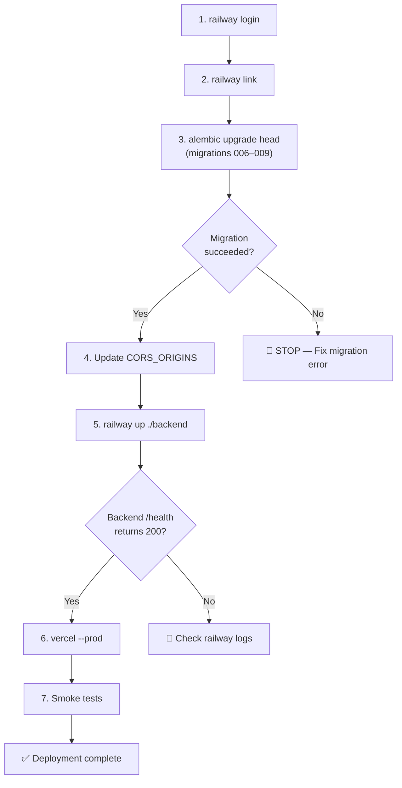

# Deployment Plan — `production` Branch → gosmartclinic.com

**Branch:** `production` @ `2981a30` | **Date:** 2026-10-27

---

## What's Being Deployed

The full appointment system feature (65 commits over `dev-prod`):
- Calendar UI with booking, rescheduling, and cancellation
- Doctor working hours persistence (API + DB)
- Patient vitals capture during booking
- Drawer-based appointment details
- DEMO_WEEK_EVENTS purge (production safety)
- 4 new Alembic migrations (`006`–`009`)

---

## Pre-Deployment Checklist

| # | Check | Status |
|---|---|---|
| 1 | `tsc --noEmit` — 0 errors | ✅ |
| 2 | `npm run build` — all 8 routes | ✅ |
| 3 | `pytest` — 149/149 passed | ✅ |
| 4 | `npm test` — all frontend suites 100% | ✅ |
| 5 | DEMO_WEEK_EVENTS purged | ✅ |
| 6 | On `production` branch, pushed to `origin/production` | ✅ |

---

## Deployment Steps

> [!IMPORTANT]
> Execute steps **in this exact order**. Database schema must be updated before the backend boots with new models, and the backend must be live before the frontend calls new API endpoints.

### Step 1: Railway CLI Login
```bash
railway login
```
> Your previous Railway session has expired. This opens a browser-based OAuth flow.

### Step 2: Link Railway Project
```bash
railway link
```
> Select project **doctors-platform** → service **backend**. This ensures subsequent commands target the correct Railway service.

### Step 3: Database Migration (Neon PostgreSQL)

Run the 4 new Alembic migrations (`006`–`009`) against production Neon:

```bash
cd backend
DATABASE_URL="postgresql+psycopg://neondb_owner:<password>@ep-cool-dream-b433f1sa.c-6.us-east-2.aws.neon.tech/neondb?sslmode=require" \
  python3 -m alembic upgrade head
```

**Expected output:**
```
Running upgrade 005 -> 006, appointment system foundation
Running upgrade 006 -> 007, appointment active slot unique index
Running upgrade 007 -> 008, add patient details to appointments
Running upgrade 008 -> 009, add working hours to doctor
```

> [!CAUTION]
> Get the `DATABASE_URL` from Railway dashboard or `railway variables`. Do not commit the production password. Verify the migration succeeded before proceeding.

### Step 4: Update CORS Origins (if `gosmartclinic.com` is new)

```bash
railway variable set CORS_ORIGINS='["https://gosmartclinic.com","https://www.gosmartclinic.com","https://doctors-platform-eight.vercel.app"]'
```

> Preserves the old Vercel URL as a fallback while adding the custom domain.

### Step 5: Deploy Backend to Railway

```bash
railway up ./backend --path-as-root --service backend --detach
```

**Verification:**
```bash
curl -s https://backend-production-b26c.up.railway.app/api/v1/health
# Expect: {"status":"healthy", ...}

curl -s -o /dev/null -w "%{http_code}" https://backend-production-b26c.up.railway.app/api/v1/doctor/working-hours
# Expect: 401 (endpoint exists, auth required) — NOT 404
```

### Step 6: Deploy Frontend to Vercel

```bash
vercel --prod --archive=tgz --yes
```

**Verification:**
```bash
curl -I -s https://gosmartclinic.com | grep -E "x-vercel-cache|etag"
# etag should differ from the pre-deployment value
```

### Step 7: Post-Deployment Smoke Tests

```bash
# 1. Homepage loads
curl -s -o /dev/null -w "%{http_code}" https://gosmartclinic.com
# Expect: 200

# 2. Backend health
curl -s https://backend-production-b26c.up.railway.app/api/v1/health
# Expect: healthy, sentry_enabled: true

# 3. New working-hours endpoint is routable
curl -s -o /dev/null -w "%{http_code}" https://backend-production-b26c.up.railway.app/api/v1/doctor/working-hours
# Expect: 401 (not 404)

# 4. CSP headers include Railway backend
curl -I -s https://gosmartclinic.com | grep "connect-src"
# Should contain: https://backend-production-b26c.up.railway.app

# 5. Login and test calendar view manually in browser
```

---

## Rollback Plan

If something goes wrong after deployment:

| Layer | Rollback Command |
|---|---|
| **Frontend** | `vercel rollback --yes` (instant, reverts to previous Vercel deployment) |
| **Backend** | `railway up` the previous Docker image, or redeploy from `dev-prod` branch |
| **Database** | `DATABASE_URL="..." python3 -m alembic downgrade 005` (rolls back migrations 006–009) |

> [!WARNING]
> Database downgrade (`alembic downgrade`) will **drop** the `appointments`, `schedules`, and `working_hours` columns added by migrations 006–009. Only use if no real patient data has been entered.

---

## Execution Flow

