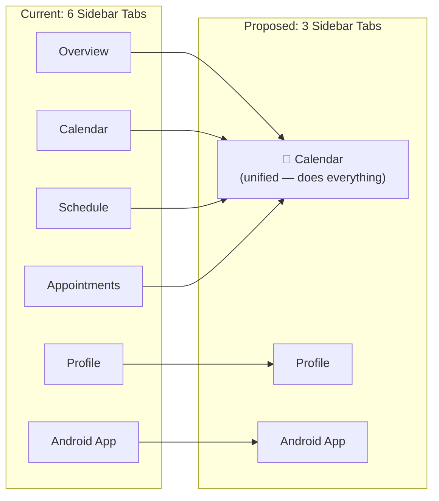
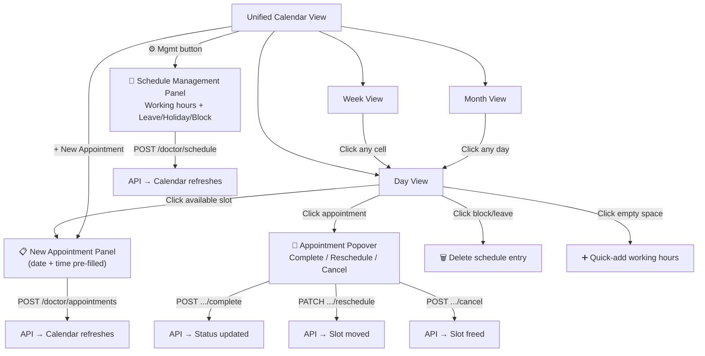

# Unified Calendar UI — Google Calendar-Style Design

> [!IMPORTANT]
> **Core idea:** Replace the 4 tabs (Overview, Calendar, Schedule, Appointments) with **one Google Calendar-style view** that handles everything — viewing, creating schedules, booking appointments, and managing status — all from a single surface.

---

## Current vs. Proposed Navigation



---

## Overall Layout

```
┌──────────────────────────────────────────────────────────────────────────────┐
│  🟦 DocSpace  |  Doctor Portal         [Copy Link] [Public Page]  👤 Dr. X  │
├────────┬─────────────────────────────────────────────────────────────────────┤
│        │                                                                     │
│  📅    │  ┌─ TOOLBAR ──────────────────────────────────────────────────────┐ │
│ Calendar│  │ [Today] [◀] [▶]  October 2026          [Day] [Week] [Month]  │ │
│        │  │                                  [+ New Appointment] [⚙ Mgmt] │ │
│  👤    │  └───────────────────────────────────────────────────────────────┘ │
│ Profile│                                                                     │
│        │  ┌─ SUMMARY BAR ────────────────────────────────────────────────┐  │
│  📱    │  │ 🟢 Available: 6  │  🔵 Booked: 3  │  ✅ Done: 1  │  🔴 2   │  │
│ Android│  └──────────────────────────────────────────────────────────────┘  │
│        │                                                                     │
│        │  ┌─ CALENDAR BODY (varies by view mode) ────────────────────────┐ │
│        │  │                                                               │ │
│        │  │  (Day View / Week View / Month View shown below)             │ │
│        │  │                                                               │ │
│        │  └───────────────────────────────────────────────────────────────┘ │
│        │                                                                     │
├────────┴─────────────────────────────────────────────────────────────────────┤
```

---

## View Modes

### 1. Day View (Default — Google Calendar style time grid)

The primary working view. A vertical time grid from the first to last working hour, with colored blocks for each event type.

```
┌──────────────────────────────────────────────────────────────────────┐
│ [Today] [◀] [▶]  Mon, 12 Oct 2026        [Day] [Week] [Month]      │
│                                           [+ New Appointment]       │
├──────────────────────────────────────────────────────────────────────┤
│ 🟢 Available: 6  |  🔵 Booked: 3  |  ✅ Completed: 1  |  🟡 Blocked: 1  │
├──────────┬───────────────────────────────────────────────────────────┤
│          │                                                           │
│  08:00   │                                                           │
│  ........│...........................................................│
│  09:00   │ ░░░░░░░░░░░░░░░░░░░░░░░░░░░░░░░░░░░░░░░░░░░░░░░░░░░░░░  │
│          │ ░  🟢 Available Slot                        [+ Book]  ░  │
│  09:30   │ ░░░░░░░░░░░░░░░░░░░░░░░░░░░░░░░░░░░░░░░░░░░░░░░░░░░░░░  │
│          │ ██████████████████████████████████████████████████████████  │
│  10:00   │ █  🔵 Patient A — General Checkup            BOOKED   █  │
│          │ █     📞 9876543210     [✅ Complete] [🔄 Reschedule] █  │
│          │ ██████████████████████████████████████████████████████████  │
│  10:00   │ ██████████████████████████████████████████████████████████  │
│          │ █  🔵 Patient B — Follow-up                  BOOKED   █  │
│  10:30   │ █     📞 —              [✅ Complete] [🔄 Reschedule] █  │
│          │ ██████████████████████████████████████████████████████████  │
│  10:30   │ ░░░░░░░░░░░░░░░░░░░░░░░░░░░░░░░░░░░░░░░░░░░░░░░░░░░░░░  │
│          │ ░  🟢 Available Slot                        [+ Book]  ░  │
│  11:00   │ ░░░░░░░░░░░░░░░░░░░░░░░░░░░░░░░░░░░░░░░░░░░░░░░░░░░░░░  │
│          │ ▓▓▓▓▓▓▓▓▓▓▓▓▓▓▓▓▓▓▓▓▓▓▓▓▓▓▓▓▓▓▓▓▓▓▓▓▓▓▓▓▓▓▓▓▓▓▓▓▓▓▓▓▓▓  │
│  11:30   │ ▓  🟡 BLOCKED — Clinic Meeting                   [🗑] ▓  │
│          │ ▓▓▓▓▓▓▓▓▓▓▓▓▓▓▓▓▓▓▓▓▓▓▓▓▓▓▓▓▓▓▓▓▓▓▓▓▓▓▓▓▓▓▓▓▓▓▓▓▓▓▓▓▓▓  │
│  12:00   │ ▒▒▒▒▒▒▒▒▒▒▒▒▒▒▒▒▒▒▒▒▒▒▒▒▒▒▒▒▒▒▒▒▒▒▒▒▒▒▒▒▒▒▒▒▒▒▒▒▒▒▒▒▒▒  │
│          │ ▒  ☕ LEAVE                                        [🗑] ▒  │
│  12:30   │ ▒▒▒▒▒▒▒▒▒▒▒▒▒▒▒▒▒▒▒▒▒▒▒▒▒▒▒▒▒▒▒▒▒▒▒▒▒▒▒▒▒▒▒▒▒▒▒▒▒▒▒▒▒▒  │
│  ........│...........................................................│
│  13:00   │  (No working hours — grey/empty)                          │
│  ........│...........................................................│
│  16:00   │ ░░░░░░░░░░░░░░░░░░░░░░░░░░░░░░░░░░░░░░░░░░░░░░░░░░░░░░  │
│          │ ░  🟢 Available Slot                        [+ Book]  ░  │
│  16:30   │ ░░░░░░░░░░░░░░░░░░░░░░░░░░░░░░░░░░░░░░░░░░░░░░░░░░░░░░  │
│          │ ████████████████████████████████████████████████████████    │
│  17:00   │ █  ✅ Patient C — Blood work             COMPLETED    █  │
│          │ ████████████████████████████████████████████████████████    │
│          │ ░░░░░░░░░░░░░░░░░░░░░░░░░░░░░░░░░░░░░░░░░░░░░░░░░░░░░░  │
│  17:30   │ ░  🟢 Available Slot                        [+ Book]  ░  │
│          │ ░░░░░░░░░░░░░░░░░░░░░░░░░░░░░░░░░░░░░░░░░░░░░░░░░░░░░░  │
│  18:00   │                                                           │
│          │                                                           │
└──────────┴───────────────────────────────────────────────────────────┘
```

**Interactions on Day View:**
- **Click an available slot** → Opens "New Appointment" inline popover (pre-fills date + time)
- **Click a booked appointment** → Expands detail card with Complete / Reschedule / Cancel actions
- **Click a blocked/leave block** → Shows delete (🗑) action
- **Click empty space (non-working hour)** → Opens "Add Working Hours" quick-add for that time range

---

### 2. Week View (7-column time grid)

Like Google Calendar's week view — 7 columns showing Mon–Sun with the same color-coded blocks vertically.

```
┌──────────────────────────────────────────────────────────────────────────────┐
│ [Today] [◀] [▶]  Oct 12 – 18, 2026               [Day] [Week] [Month]      │
├──────┬─────────┬─────────┬─────────┬─────────┬─────────┬─────────┬─────────┤
│      │  Mon 12 │  Tue 13 │  Wed 14 │  Thu 15 │  Fri 16 │  Sat 17 │  Sun 18 │
├──────┼─────────┼─────────┼─────────┼─────────┼─────────┼─────────┼─────────┤
│09:00 │ 🟢      │ 🟢      │ 🟢      │ 🟢      │ 🟢      │         │         │
│09:30 │ 🔵 Pat.A│ 🟢      │ 🔵 Pat.D│ 🟢      │ 🟢      │         │         │
│10:00 │ 🔵 Pat.B│ 🔵 Pat.C│ 🟢      │ 🔵 Pat.E│ 🟢      │         │         │
│10:30 │ 🟢      │ 🟢      │ 🟢      │ 🟢      │ 🟡 Blk  │         │         │
│11:00 │ 🟡 Blk  │ 🟢      │ 🟢      │ ☕ Leave │ 🟡 Blk  │         │         │
│11:30 │ 🟡 Blk  │ 🟢      │ ✅ Pat.F│ ☕ Leave │ 🟢      │         │         │
│12:00 │ ☕ Leave │ 🟢      │ 🟢      │ ☕ Leave │ 🟢      │         │         │
│12:30 │ ☕ Leave │ 🟢      │ 🟢      │ 🟢      │ 🟢      │         │         │
│  ⋯   │         │         │         │         │         │         │         │
│16:00 │ 🟢      │ 🟢      │ 🟢      │ 🟢      │         │         │         │
│16:30 │ ✅ Pat.C│ 🟢      │ 🔵 Pat.G│ 🟢      │         │         │         │
│17:00 │ 🟢      │ 🟢      │ 🟢      │ 🟢      │         │         │         │
└──────┴─────────┴─────────┴─────────┴─────────┴─────────┴─────────┴─────────┘
```

**Interactions:** Click any cell → opens Day View for that date with the slot pre-selected.

---

### 3. Month View (Mini calendar + daily event counts)

A traditional month grid. Each day cell shows colored dot indicators for event density.

```
┌──────────────────────────────────────────────────────────────────────────┐
│ [Today] [◀] [▶]  October 2026                    [Day] [Week] [Month]  │
├──────────┬──────────┬──────────┬──────────┬──────────┬──────────┬───────┤
│   Mon    │   Tue    │   Wed    │   Thu    │   Fri    │   Sat    │  Sun  │
├──────────┼──────────┼──────────┼──────────┼──────────┼──────────┼───────┤
│          │          │    1     │    2     │    3     │    4     │   5   │
│          │          │ 🔵3 🟢5 │ 🔵2 🟢6 │ 🔵4 🟢4 │          │       │
├──────────┼──────────┼──────────┼──────────┼──────────┼──────────┼───────┤
│    6     │    7     │    8     │    9     │   10     │   11     │  12   │
│          │ 🔵2 🟢6 │ 🔵3 🟢5 │ 🔵1 🟢7 │ 🔵4 🟢4 │          │       │
├──────────┼──────────┼──────────┼──────────┼──────────┼──────────┼───────┤
│   13     │   14     │   15     │   16     │   17     │   18     │  19   │
│ 🔵2 🟢6 │ 🔵3 🟢5 │ 🟣HOLIDAY│ 🔵2 🟢6 │ 🔵1 🟢7 │          │       │
├──────────┼──────────┼──────────┼──────────┼──────────┼──────────┼───────┤
│   20     │   21     │   22     │   23     │   24     │   25     │  26   │
│ 🔵3 🟢5 │ 🔵2 🟢6 │ 🔵4 🟢4 │ 🔵1 🟢7 │ 🔵2 🟢6 │          │       │
├──────────┼──────────┼──────────┼──────────┼──────────┼──────────┼───────┤
│   27     │   28     │   29     │   30     │   31     │          │       │
│ 🔵2 🟢6 │ 🔵3 🟢5 │ 🔵1 🟢7 │ 🔵2 🟢6 │ 🔵2 🟢6 │          │       │
└──────────┴──────────┴──────────┴──────────┴──────────┴──────────┴───────┘

Legend: 🔵 = Booked appointments  🟢 = Available slots  🟣 = Holiday/Leave
```

**Interactions:** Click any day → switches to Day View for that date.

---

## Inline Action Surfaces (No Separate Tabs Needed)

### A. "+ New Appointment" — Slide-over Panel

Triggered from: toolbar button OR clicking an available slot.

```
┌──────────────────────────────────────┐
│  ✕  New Appointment                  │
├──────────────────────────────────────┤
│                                      │
│  Patient Name *                      │
│  ┌────────────────────────────────┐  │
│  │ Ahmed Khan                     │  │
│  └────────────────────────────────┘  │
│                                      │
│  Patient Contact                     │
│  ┌────────────────────────────────┐  │
│  │ 9876543210                     │  │
│  └────────────────────────────────┘  │
│                                      │
│  Date                                │
│  ┌────────────────────────────────┐  │
│  │ 📅 2026-10-12  (pre-filled)   │  │
│  └────────────────────────────────┘  │
│                                      │
│  Time Slot (auto-loaded from API)    │
│  ┌────────────────────────────────┐  │
│  │ ● 09:00 – 09:30               │  │
│  │ ○ 10:30 – 11:00               │  │
│  │ ○ 16:00 – 16:30               │  │
│  │ ○ 17:00 – 17:30               │  │
│  └────────────────────────────────┘  │
│                                      │
│  Reason                              │
│  ┌────────────────────────────────┐  │
│  │ General checkup                │  │
│  └────────────────────────────────┘  │
│                                      │
│  Doctor Notes (private)              │
│  ┌────────────────────────────────┐  │
│  │ First visit, check BP          │  │
│  └────────────────────────────────┘  │
│                                      │
│  ┌────────────────────────────────┐  │
│  │      📋 Book Appointment      │  │
│  └────────────────────────────────┘  │
└──────────────────────────────────────┘
```

---

### B. "⚙ Schedule Management" — Slide-over Panel

Triggered from the **⚙ Mgmt** button in the toolbar. This replaces the entire Schedule tab.

```
┌──────────────────────────────────────┐
│  ✕  Schedule Management              │
├──────────────────────────────────────┤
│                                      │
│  ── Working Hours ──────────────     │
│                                      │
│  Date: 📅 2026-10-12                 │
│  Start: [09:00]  End: [13:00]        │
│  [+ Add Working Hours]               │
│                                      │
│  Existing:                           │
│  ┌──────────────────────────────┐    │
│  │ Oct 12  09:00–13:00  AVAIL  🗑│   │
│  │ Oct 12  16:00–20:00  AVAIL  🗑│   │
│  │ Oct 13  09:00–13:00  AVAIL  🗑│   │
│  └──────────────────────────────┘    │
│                                      │
│  ── Leave / Holiday / Block ──────   │
│                                      │
│  Type: [LEAVE ▾]                     │
│  Date: 📅 2026-10-15                 │
│  Start: [09:00]  End: [17:00]        │
│  Reason: [________________]          │
│  [+ Add Entry]                       │
│                                      │
│  Existing:                           │
│  ┌──────────────────────────────┐    │
│  │ Oct 15  Full Day  HOLIDAY 🗑 │    │
│  │ Oct 18  10:00-12:00  LEAVE 🗑│    │
│  │ Oct 12  11:00-12:00  BLOCK 🗑│    │
│  └──────────────────────────────┘    │
│                                      │
└──────────────────────────────────────┘
```

---

### C. Appointment Detail — Click-to-Expand Popover

When clicking any appointment block in Day/Week view:

```
┌───────────────────────────────────────┐
│  🔵 Patient A — General Checkup      │
├───────────────────────────────────────┤
│  📅 Mon, 12 Oct 2026                 │
│  🕐 09:30 – 10:00                    │
│  📞 9876543210                        │
│  📝 Reason: General checkup          │
│  🔒 Notes: First visit, check BP     │
│  Status: ● BOOKED                    │
│                                       │
│  ┌──────┐ ┌────────────┐ ┌────────┐  │
│  │✅Done│ │🔄Reschedule│ │❌Cancel│  │
│  └──────┘ └────────────┘ └────────┘  │
└───────────────────────────────────────┘
```

---

## Color System

| Event Type       | Background     | Border         | Text           | Tailwind Classes                              |
|:-----------------|:---------------|:---------------|:---------------|:----------------------------------------------|
| **Available**    | `emerald-50`   | `emerald-300`  | `emerald-800`  | `bg-emerald-50 border-emerald-300` (dashed)   |
| **Booked**       | `brand-600`    | `brand-700`    | `white`        | `bg-brand-600 text-white`                     |
| **Completed**    | `slate-100`    | `slate-300`    | `slate-700`    | `bg-slate-100 border-slate-300`               |
| **Cancelled**    | `red-50`       | `red-200`      | `red-600`      | `bg-red-50 border-red-200` (strikethrough)    |
| **Leave**        | `slate-100`    | `slate-300`    | `slate-600`    | `bg-slate-100 border-slate-300` + ☕ icon      |
| **Holiday**      | `purple-50`    | `purple-300`   | `purple-900`   | `bg-purple-50 border-purple-300` + 🎉 icon    |
| **Blocked**      | `amber-50`     | `amber-300`    | `amber-900`    | `bg-amber-50 border-amber-300` + ⚠ icon       |
| **Non-working**  | `slate-50`     | none           | `slate-300`    | Faded grey with diagonal hatch pattern         |

---

## Interaction Flow Diagram



---

## Component Architecture

```
components/dashboard/
├── UnifiedCalendar.tsx          ← Main container (replaces CalendarTab + OverviewTab)
│   ├── CalendarToolbar.tsx      ← [Today] [◀▶] [Day|Week|Month] [+ New Apt] [⚙ Mgmt]
│   ├── CalendarSummaryBar.tsx   ← Stats pills (Available: 6, Booked: 3, etc.)
│   ├── DayView.tsx              ← Vertical time grid with event blocks
│   ├── WeekView.tsx             ← 7-column time grid
│   ├── MonthView.tsx            ← Month grid with event dot indicators
│   ├── EventBlock.tsx           ← Renders single event (available/booked/leave/etc.)
│   ├── AppointmentPopover.tsx   ← Click-detail with Complete/Reschedule/Cancel
│   ├── NewAppointmentPanel.tsx  ← Slide-over form (reuse from AppointmentsTab)
│   └── SchedulePanel.tsx       ← Slide-over for working hours + leave mgmt
```

**New `DashboardTabId`** type becomes:

```typescript
export type DashboardTabId = "calendar" | "profile" | "android";
```

---

## API Calls Per View

| View Mode | API Calls | Endpoint |
|:----------|:----------|:---------|
| Day View  | 1 | `GET /doctor/calendar?from={date}&to={date}` |
| Week View | 1 | `GET /doctor/calendar?from={monday}&to={sunday}` |
| Month View | 1 | `GET /doctor/calendar?from={first}&to={last}` (max 31 days ✅) |
| New Appointment | 1 | `GET /doctor/available-slots?date={date}` |
| Schedule Mgmt | 1 | `GET /doctor/schedule?from=...&to=...` |

> [!TIP]
> The existing `/doctor/calendar` endpoint already returns the composite view needed for all 3 view modes — schedule entries + appointments merged and time-sorted. No new backend endpoints needed.

---

## Responsive Behavior

| Breakpoint | Behavior |
|:-----------|:---------|
| `lg` (1024px+) | Full sidebar + calendar grid + slide-over panels |
| `md` (768-1023px) | Collapsed sidebar (icons only) + calendar grid |
| `sm` (< 768px) | Bottom tab bar + Day View only (Week/Month hidden) + full-screen modals |

---

## Key UX Decisions Needed

> [!IMPORTANT]
> **Questions to resolve before implementation:**

1. **Default view on load** — Day (today) like current, or Week (current week)?
2. **Cancelled appointments** — Show them in the calendar with strikethrough, or hide completely?
3. **Drag-to-reschedule** — Allow dragging an appointment block to a new slot (Google Calendar style), or keep it button-only via the popover?
4. **Empty days in Month View** — Show them greyed out, or omit entirely?
5. **Quick-add on empty space** — When clicking a non-working hour, should it prompt to add working hours for just that slot, or open the full Schedule Management panel?
