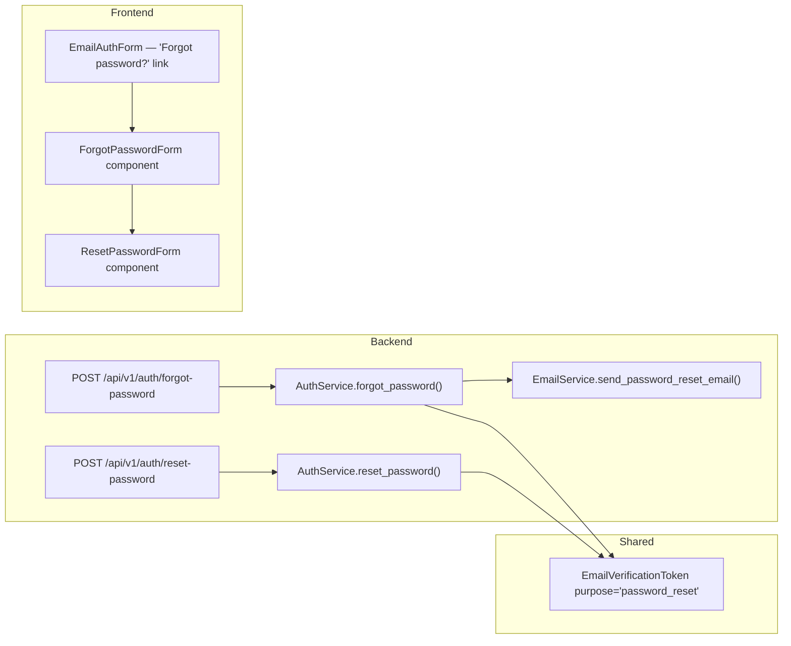
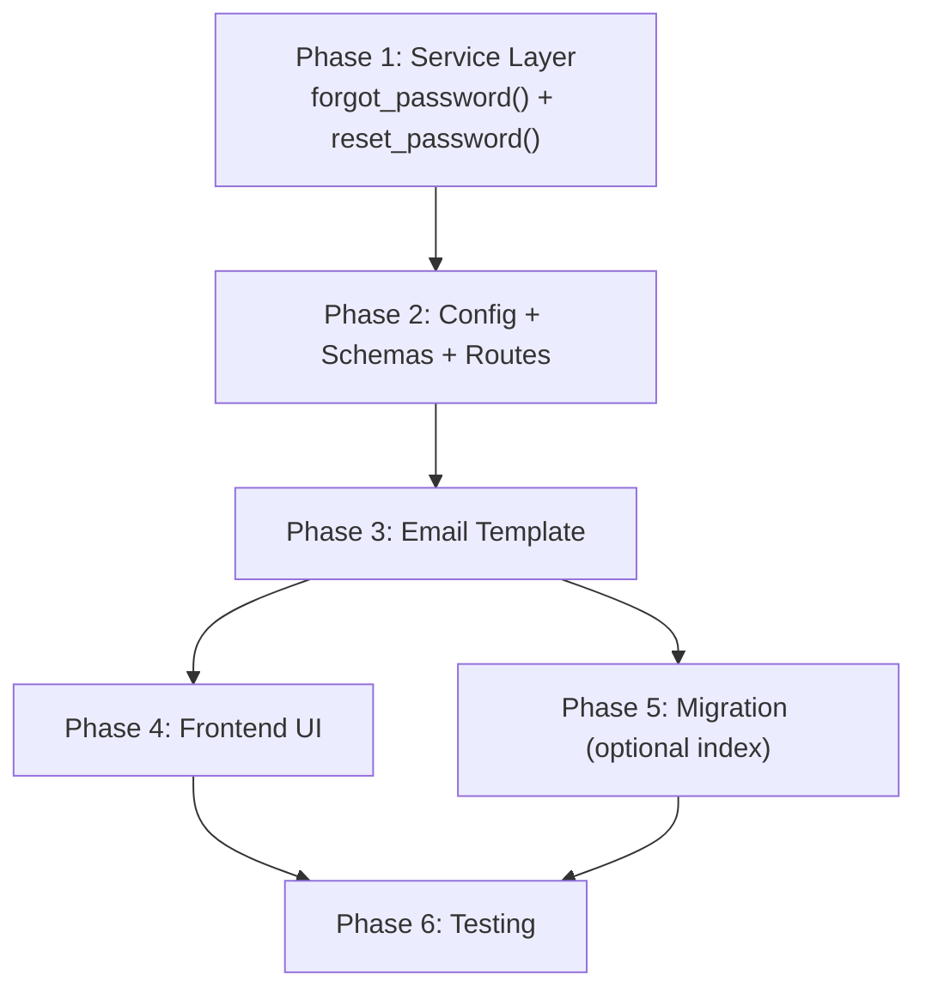

# Password Reset Feature Plan

## 1. Overview

Add **Forgot Password / Reset Password** to the existing email authentication system. Reuses the `EmailVerificationToken` model (with `purpose="password_reset"`), the existing email delivery infrastructure, and the established security patterns (SHA-256 hashed tokens, constant-time comparison, brute-force protection, rate limiting).

> [!IMPORTANT]
> This feature unlocks two blocked user journeys:
> 1. Email users who forgot their password
> 2. Google-only users who want to add email/password login (`login_email` already says *"sign in with Google or reset password"*)

---

## 2. Architecture — What Already Exists vs. What's New

### Reused (no changes)
| Component | Path |
|---|---|
| `EmailVerificationToken` model | `backend/app/models/verification_token.py` — `purpose` column already supports arbitrary strings |
| `generate_verification_token()` → OTP + URL token | `backend/app/core/security.py` |
| `hash_token()` / `verify_token_hash()` | `backend/app/core/security.py` |
| `hash_password()` / `verify_password()` | `backend/app/core/security.py` |
| `validate_password_strength()` | `backend/app/schemas/auth.py` |
| `validate_email_id()` | `backend/app/schemas/auth.py` |
| Email delivery backends (Resend/SMTP/Console/Memory) | `backend/app/services/email_service.py` |
| `DUMMY_BCRYPT_HASH` timing side-channel mitigation | `backend/app/core/security.py` |
| SlowAPI rate limiter | `backend/app/core/rate_limit.py` |

### New / Modified



---

## 3. Implementation Phases

### Phase 1: Backend — Service Layer

**File**: `backend/app/services/auth_service.py`

#### 3.1.1 `AuthService.forgot_password(db, email) → dict`

1. Validate email with `validate_email_id()`.
2. Look up `Doctor` by email.
3. **If not found**: burn time with `verify_password("dummy", DUMMY_BCRYPT_HASH)`, return generic success message (no email enumeration).
4. **If found but inactive**: return same generic message (don't reveal account status).
5. **Rate limit (domain-level)**: query `EmailVerificationToken` with `purpose="password_reset"` and `sent_at IS NOT NULL`, ordered by `sent_at DESC`. If last `sent_at` < 60 seconds ago → raise HTTP 429 with `Retry-After` header (mirrors `resend_verification` pattern).
6. **Generate token pair**: `otp, token = generate_verification_token()`.
7. **Invalidate prior pending reset tokens**: update all unused tokens with `purpose="password_reset"` for this doctor → set `used_at = now`.
8. **Create two `EmailVerificationToken` rows**: one with `hash_token(otp)`, one with `hash_token(token)`, both with `purpose="password_reset"` and `expires_at = now + PASSWORD_RESET_EXPIRE_MINUTES`.
9. **Send email**: call `email_service.send_password_reset_email(to_email, doctor_name, otp, token, tenant_slug)`.
10. If delivery succeeds → set `sent_at` on both token rows, commit. If delivery fails → raise HTTP 503.
11. Return `{"message": "If an account exists with this email, a password reset link has been sent."}`.

#### 3.1.2 `AuthService.reset_password(db, raw_code_or_token, email, new_password) → AuthResponse`

1. Validate `new_password` with `validate_password_strength(new_password, email=email)`.
2. If `email` provided: validate with `validate_email_id()`, look up `Doctor`.
3. Compute `target_hash = hash_token(raw_code_or_token)`.
4. Query `EmailVerificationToken` with `purpose="password_reset"` matching hash (and doctor_id if email provided).
5. **Brute-force protection** (same pattern as `verify_email`):
   - If token not found and doctor exists → increment `failed_login_attempts`. If ≥ 5 → invalidate all pending reset tokens, raise 400.
   - If token not found → raise 400 "Invalid reset code or token."
6. **Already used** → raise 400.
7. **Expired** → raise 400 "Reset token has expired. Please request a new one."
8. **Verify new password ≠ current password**: if `doctor.hashed_password` and `verify_password(new_password, doctor.hashed_password)` → raise 400 "New password must be different from the current password."
9. **Apply reset**:
   - `doctor.hashed_password = hash_password(new_password)`
   - `doctor.failed_login_attempts = 0`
   - `doctor.locked_until = None`
   - If `doctor.auth_provider == "google"` and no prior password → update `auth_provider = "email"` (or keep as "google" — both providers work).
   - Invalidate all pending `password_reset` tokens for this doctor (set `used_at = now`).
   - Commit.
10. **Auto-login**: generate JWT, return `AuthResponse` with doctor + tenant.

---

### Phase 2: Backend — Config, Schemas, Routes

#### 3.2.1 Config (`backend/app/core/config.py`)

Add:
```python
PASSWORD_RESET_EXPIRE_MINUTES: int = 30
RATE_LIMIT_PASSWORD_RESET: str = "3/minute"
```

#### 3.2.2 Schemas (`backend/app/schemas/auth.py`)

Add:
```python
class ForgotPasswordRequest(BaseModel):
    email: str

    @field_validator("email")
    @classmethod
    def check_email(cls, v: str) -> str:
        return validate_email_id(v)

class ResetPasswordRequest(BaseModel):
    new_password: str
    email: Optional[str] = None
    code: Optional[str] = None    # 6-digit OTP
    token: Optional[str] = None   # URL-safe token

    @field_validator("email")
    @classmethod
    def check_email_if_provided(cls, v: Optional[str]) -> Optional[str]:
        return validate_email_id(v) if v else v

    @model_validator(mode="after")
    def require_code_or_token(self):
        if not self.code and not self.token:
            raise ValueError("Either code or token is required")
        return self
```

#### 3.2.3 Routes (`backend/app/api/routes/auth.py`)

Add two endpoints:
```
POST /api/v1/auth/forgot-password   → ForgotPasswordRequest → {"message": ...}
POST /api/v1/auth/reset-password    → ResetPasswordRequest  → AuthResponse
```

Both rate-limited with `RATE_LIMIT_PASSWORD_RESET` via SlowAPI.

---

### Phase 3: Backend — Email Template

**File**: `backend/app/services/email_service.py`

Add `send_password_reset_email(to_email, doctor_name, otp, token, tenant_slug)` method to `EmailServiceManager`:
- Subject: "Reset your GoSmartClinic password"
- HTML body with:
  - 6-digit OTP prominently displayed
  - Magic link: `{FRONTEND_URL}/auth/reset-password?token={token}&email={email}`
  - 30-minute expiry notice
  - "If you didn't request this, ignore this email" disclaimer
- Follows the same HTML template pattern as `send_verification_email`.

---

### Phase 4: Frontend — UI Components

#### 3.4.1 "Forgot password?" link in login form

**File**: `components/auth/EmailAuthForm.tsx`

- Add a `"Forgot password?"` link below the password field in the login view.
- Clicking navigates to `/auth/forgot-password` (or toggles view state).

#### 3.4.2 Forgot Password Page

**File**: `app/auth/forgot-password/page.tsx` (new)  
**Component**: `components/auth/ForgotPasswordForm.tsx` (new)

Flow:
1. **Email input** → submit calls `apiFetch("/api/v1/auth/forgot-password", { email })`.
2. On success → transition to **"Check your email"** view with:
   - OTP input field (6-digit, same UI as verification)
   - Resend button with 60s cooldown
   - "Back to login" link

#### 3.4.3 Reset Password Page

**File**: `app/auth/reset-password/page.tsx` (new)  
**Component**: `components/auth/ResetPasswordForm.tsx` (new)

Entry points:
- **From OTP**: user enters 6-digit code on forgot-password page → transitions to password form.
- **From email link**: `?token=xxx&email=yyy` query params → pre-fills token, shows password form directly.

Form fields:
- New password (with strength indicator reusing existing validation)
- Confirm password (client-side match check)
- Submit → `apiFetch("/api/v1/auth/reset-password", { new_password, code|token, email })`
- On success (AuthResponse) → store JWT, redirect to dashboard/onboarding.

#### 3.4.4 API Client Functions

**File**: `lib/api.ts`

Add:
```typescript
export function forgotPassword(email: string) { ... }
export function resetPassword(params: { new_password: string; email?: string; code?: string; token?: string }) { ... }
```

---

### Phase 5: Database Migration

**File**: `backend/alembic/versions/012_add_password_reset_purpose_support.py`

> [!NOTE]
> No schema migration required — `EmailVerificationToken.purpose` is already a `String(50)` column that accepts `"password_reset"`. This migration is **optional** and would only add a composite index for query performance:

```python
# Optional index for faster reset token lookups
Index("ix_evt_doctor_purpose_reset", "doctor_id", "purpose",
      postgresql_where=text("purpose = 'password_reset'"))
```

---

### Phase 6: Comprehensive Testing

#### 3.6.1 Backend Tests (`backend/tests/test_password_reset.py`)

| # | Test Case | Layer |
|---|---|---|
| 1 | `test_forgot_password_sends_email` — happy path, token created with `purpose="password_reset"` | L2 |
| 2 | `test_forgot_password_nonexistent_email_no_leak` — returns 200, no email sent, timing-safe | L2 |
| 3 | `test_forgot_password_inactive_account_no_leak` — returns 200, no email sent | L2 |
| 4 | `test_forgot_password_60s_cooldown` — second request within 60s → 429 with Retry-After | L2 |
| 5 | `test_forgot_password_google_only_account_sends_email` — Google users can set a password | L2 |
| 6 | `test_reset_password_valid_otp` — OTP resets password, returns AuthResponse with JWT | L2 |
| 7 | `test_reset_password_valid_url_token` — URL token resets password, returns AuthResponse | L2 |
| 8 | `test_reset_password_expired_token` — returns 400 | L2 |
| 9 | `test_reset_password_already_used_token` — replay → returns 400 | L2 |
| 10 | `test_reset_password_wrong_code_increments_attempts` — brute-force counter | L2 |
| 11 | `test_reset_password_5_failures_invalidates_all_tokens` — lockout protection | L2 |
| 12 | `test_reset_password_same_as_current_rejected` — must differ from current password | L2 |
| 13 | `test_reset_password_weak_password_rejected` — password policy enforcement | L1 |
| 14 | `test_reset_password_auto_login_returns_jwt` — JWT is valid, `/me` works | L2 |
| 15 | `test_reset_password_clears_lockout` — `failed_login_attempts=0`, `locked_until=None` | L2 |
| 16 | `test_reset_does_not_affect_email_verification_tokens` — `purpose="email_verification"` tokens untouched | L2 |
| 17 | `test_concurrent_reset_requests` — ThreadPoolExecutor, exactly one succeeds | L3 |
| 18 | `test_reset_password_email_delivery_failure_503` — SMTP error → 503, no token committed | L3 |

#### 3.6.2 Frontend Verification (`scripts/verify_password_reset_ui.mjs`)

| # | Check |
|---|---|
| 1 | Forgot password link exists in login form |
| 2 | Forgot password form submits to correct endpoint |
| 3 | OTP input field rendered after email submission |
| 4 | Reset password form validates matching passwords client-side |
| 5 | Password strength indicator present |
| 6 | Successful reset stores JWT and redirects |
| 7 | Error states (429, 400, 503) render accessible alerts |
| 8 | Magic link with `?token=&email=` pre-populates correctly |

---

## 4. Security Considerations

| Concern | Mitigation |
|---|---|
| Email enumeration | `forgot_password` always returns 200 with generic message |
| Timing side-channel | `DUMMY_BCRYPT_HASH` consumed on unknown email |
| Brute-force OTP guessing | 5-attempt counter → invalidate all tokens |
| Token replay | `used_at` set on all tokens after successful reset |
| Rate limiting | 60s domain-level cooldown + SlowAPI `3/minute` route-level |
| Cross-purpose token reuse | `purpose="password_reset"` vs `"email_verification"` isolated in all queries |
| Same-password reuse | Explicit check before accepting new password |
| Stale reset after password change | All pending reset tokens invalidated on successful reset |

---

## 5. File Change Summary

| File | Action | Description |
|---|---|---|
| `backend/app/core/config.py` | Modify | Add `PASSWORD_RESET_EXPIRE_MINUTES`, `RATE_LIMIT_PASSWORD_RESET` |
| `backend/app/schemas/auth.py` | Modify | Add `ForgotPasswordRequest`, `ResetPasswordRequest` |
| `backend/app/services/auth_service.py` | Modify | Add `forgot_password()`, `reset_password()` methods |
| `backend/app/services/email_service.py` | Modify | Add `send_password_reset_email()` method + HTML template |
| `backend/app/api/routes/auth.py` | Modify | Add `/forgot-password`, `/reset-password` routes |
| `lib/api.ts` | Modify | Add `forgotPassword()`, `resetPassword()` API functions |
| `components/auth/EmailAuthForm.tsx` | Modify | Add "Forgot password?" link |
| `components/auth/ForgotPasswordForm.tsx` | Create | Email input + OTP entry form |
| `components/auth/ResetPasswordForm.tsx` | Create | New password + confirm form |
| `app/auth/forgot-password/page.tsx` | Create | Next.js page wrapper |
| `app/auth/reset-password/page.tsx` | Create | Next.js page wrapper (handles `?token=&email=` params) |
| `backend/tests/test_password_reset.py` | Create | 18 test cases across L1/L2/L3 |
| `scripts/verify_password_reset_ui.mjs` | Create | Frontend verification script |

---

## 6. Execution Order



**Estimated scope**: ~600 LOC backend, ~400 LOC frontend, ~500 LOC tests.

---

## 7. Rollback

- Revert commit: `git revert <commit-sha>`
- No database migration to downgrade (unless optional index was added → `alembic downgrade -1`)
- Remove `PASSWORD_RESET_EXPIRE_MINUTES` and `RATE_LIMIT_PASSWORD_RESET` from Railway env (no-op if unset)

