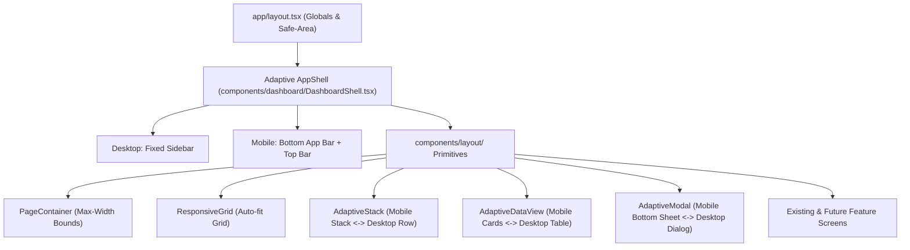

# 📱💻 Universal Responsive UI & Auto-Adaptive Layout System

> **Documentation Date:** October 29, 2026  
> **Status:** ✅ Implemented, Verified, & Production Ready  
> **Target Devices:** Mobile (320px–640px), Tablet (641px–1023px), Laptop/Desktop (1024px–1440px), Ultrawide (1440px+)

---

## 🎯 1. Overview & Objective

Is update ka main maqsad pure doctor platform application ko **Laptop, Tablet, aur Mobile** par pixel-perfect aur responsive banana tha. Saath hi ek aisi **Auto-Responsive Layout Architecture** set karna tha taaki aage chal kar agar koi bhi nayi screen ya feature banaya jaye, toh woh **bina kisi manual breakpoint CSS ke automatically responsive ban jaye**.

---

## 🏗️ 2. Architectural Paradigm: "Primitive-First"

Pehle screens par hardcoded `w-[600px]`, rigid flex rows, aur inconsistent media queries likhi ja rahi thi, jisse mobile par table overflow ho jata tha aur layout toot jata tha.

Ab pura system **5 Core Layout Primitives** par depend karta hai:



---

## 📝 3. Detailed File-by-File Changes

### 1. `app/globals.css` (Viewport & Safe-Area Foundation)
- **Safe-Area CSS Variables**:
  ```css
  :root {
    --sat: env(safe-area-inset-top, 0px);
    --sab: env(safe-area-inset-bottom, 0px);
    --sal: env(safe-area-inset-left, 0px);
    --sar: env(safe-area-inset-right, 0px);
  }
  ```
- **Overflow & Viewport Fix**:
  - `html, body`: `overflow-x: hidden`, `max-width: 100vw`, aur `-webkit-tap-highlight-color: transparent`.
  - Added `.pb-safe` aur `.pt-safe` utility classes for notched devices (iPhone / modern Android).
  - Added `.custom-scrollbar` class for smooth scrolling without ugly grey scrollbars.
  - Added universal `min-w-0` enforcement to prevent flex items from expanding beyond parent containers.

---

### 2. `components/layout/` (New Auto-Responsive Primitives)

#### A. `components/layout/PageContainer.tsx`
- **Purpose**: Page ka outer wrapper jo har screen par consistent horizontal margins (`px-4 sm:px-6 lg:px-8`) aur max-width boundary deta hai.
- **Sizes**: `sm` (max-w-3xl), `md` (max-w-5xl), `lg` (max-w-7xl - default), `xl` (max-w-[1400px]), `full`.

#### B. `components/layout/ResponsiveGrid.tsx`
- **Purpose**: Cards, stats, aur widgets ke liye auto-wrapping CSS Grid.
- **Auto-fit Logic**:
  ```css
  grid-template-columns: repeat(auto-fit, minmax(min(100%, 280px), 1fr));
  ```
  Is logic ki wajah se mobile screen (360px) par automatically 1 card per row, tablet (768px) par 2 cards, aur laptop (1280px) par 4 cards bina kisi media query ke fit ho jate hain.

#### C. `components/layout/AdaptiveStack.tsx`
- **Purpose**: Mobile par vertical column (`flex-col`) aur laptop/desktop par horizontal row (`md:flex-row`).
- **Use Cases**: Page headers, search/filter bars, action buttons, summary banners.

#### D. `components/layout/AdaptiveDataView.tsx`
- **Purpose**: Tables ko mobile par break hone se bachana.
- **Dual Mode**:
  - **Laptop/Desktop (>= 768px)**: Standard full interactive table with columns.
  - **Mobile (< 768px)**: Converts each row into a clean, swipeable touch Card.
  - **Fallback**: Table ko isolated horizontal scroll container me wrap karta hai with subtle scrollbar indicators.

#### E. `components/layout/AdaptiveModal.tsx`
- **Purpose**: Responsive popup dialogs.
- **Dual Mode**:
  - **Laptop/Desktop**: Centered backdrop modal dialog with max-width.
  - **Mobile**: Native app-like Bottom Sheet with top pull-down pill indicator and `.pb-safe` bottom padding.

#### F. `components/layout/index.ts`
- Barrel export file jisse kisi bhi screen par clean import kiya ja sake:
  ```tsx
  import { PageContainer, ResponsiveGrid, AdaptiveStack, AdaptiveDataView, AdaptiveModal } from "@/components/layout";
  ```

---

### 3. `components/dashboard/DashboardShell.tsx` (Adaptive App Shell)
- **Laptop / Desktop (`>= md`)**:
  - Fixed 240px Left Sidebar with Brand Logo, Navigation Tabs with active border accents, Doctor profile badge, Diagnostics button, aur Logout.
- **Mobile Devices (`< md`)**:
  - **Sticky Top Bar**: Compact header with brand logo, doctor avatar badge, and quick logout button.
  - **Fixed Bottom Navigation Bar**: Modern native mobile bottom navigation bar (Overview, Appointments, Profile, Android App) with active pills, touch feedback, aur `pb-safe` bottom padding.
  - **Viewport Content Buffer**: Added `pb-24` to content area so bottom navigation bar content ko cover na kare.

---

### 4. `components/dashboard/OverviewTab.tsx` (Screen Migration)
- **KPI Stats Cards**: `grid grid-cols-1 sm:grid-cols-2 lg:grid-cols-3` se upgrade karke `<ResponsiveGrid minItemWidth={220}>` me convert kiya gaya.
- **Today's Appointments Section**:
  - Header ko `<AdaptiveStack>` me wrap kiya.
  - Table ko `<AdaptiveDataView<AppointmentEntry>>` me convert kiya gaya. Laptop par table dikhti hai aur mobile par patient details touch cards me convert ho jati hain.
- **Quick Action Buttons**: `<ResponsiveGrid minItemWidth={260}>` me convert kiya gaya.

---

## 🚀 4. Developer Guide: How Future Screens Auto-Adapt

Kisi bhi nayi screen ko banane ke liye developer ko sirf yeh template follow karna hai. Yeh screen 100% har device par automatically responsive banegi:

```tsx
import React from "react";
import { PageContainer, AdaptiveStack, ResponsiveGrid } from "@/components/layout";

export default function AnyNewFeatureScreen() {
  return (
    <PageContainer size="lg">
      {/* 1. Header & Actions: Mobile par vertical, Desktop par horizontal */}
      <AdaptiveStack align="between" className="mb-6">
        <div>
          <h1 className="text-xl sm:text-2xl font-bold text-slate-900">Feature Screen</h1>
          <p className="text-xs sm:text-slate-500">Auto-adaptive across every screen device</p>
        </div>
        <button className="w-full sm:w-auto px-4 py-2 bg-brand-600 text-white rounded-xl text-sm font-semibold">
          Primary Action
        </button>
      </AdaptiveStack>

      {/* 2. Grid Cards: Screen size ke hisaab se auto-wrap honge */}
      <ResponsiveGrid minItemWidth={260} gap="md" className="mb-6">
        <div className="bg-white p-5 rounded-2xl border border-slate-200">Metric 1</div>
        <div className="bg-white p-5 rounded-2xl border border-slate-200">Metric 2</div>
        <div className="bg-white p-5 rounded-2xl border border-slate-200">Metric 3</div>
        <div className="bg-white p-5 rounded-2xl border border-slate-200">Metric 4</div>
      </ResponsiveGrid>

      {/* 3. Responsive 2-Column / 1-Column Content Split */}
      <div className="grid grid-cols-1 lg:grid-cols-3 gap-6">
        <div className="lg:col-span-2 bg-white p-6 rounded-2xl border border-slate-200">
          Primary Content
        </div>
        <div className="bg-white p-6 rounded-2xl border border-slate-200">
          Side Widget
        </div>
      </div>
    </PageContainer>
  );
}
```

---

### 5. `components/dashboard/calendar/` (Calendar Views, Panels & Modals)
- **`MonthView.tsx`**:
  - Wrapped month grid in `overflow-x-auto custom-scrollbar w-full` with inner `min-w-[560px] md:min-w-0` to protect small screens from squishing.
  - Responsive padding (`p-3 sm:p-5 md:p-6`) and compact pill badges on mobile (`L/B` vs `Leave/Block`, `Appt` vs `Booked`).
- **`DayView.tsx` & `WeekView.tsx`**:
  - Full-width time columns with touch-friendly 44px+ minimum height slots, responsive headers, and horizontal scroll isolation.
- **`CalendarHeader.tsx`**:
  - Wrapped date controls and view switcher in mobile-friendly wrap container with full-width toggle buttons on mobile.
- **`CalendarDrawer.tsx`**:
  - Replaced fixed left padding (`pl-6 sm:pl-10`) with `pl-0 sm:pl-10` (`w-full` on mobile phones), added `pb-safe` for iOS home indicator bars.
- **`AppointmentDetailsPanel.tsx` & `LeaveDetailsPanel.tsx`**:
  - Transformed footer action buttons (`Cancel`, `Mark Completed`, `Edit / Reschedule`) into full-width stacked layouts on mobile (`flex flex-col sm:flex-row`).
- **`SlotSelectorGrid.tsx`**:
  - Updated 30-min slot pill grid to adaptive `grid-cols-2 xs:grid-cols-3 sm:grid-cols-4` with smooth scrolling.
- **Modals (`AddAppointmentModal`, `BlockTimeModal`, `EditWorkingHoursModal`, `SlotActionModal`, `EventDetailsModal`)**:
  - Updated all action footers to responsive `flex-col-reverse sm:flex-row gap-2.5` with `w-full sm:w-auto` buttons.
  - Added horizontal wrapping to break time preview banners.

---

### 6. Additional Completed Screens
- **`components/dashboard/ProfileTab.tsx`**:
  - Responsive container padding (`p-4 sm:p-6 md:p-8`), adaptive header, and full-width save button on mobile.
- **`components/dashboard/AndroidAppTab.tsx`**:
  - Responsive download / compile buttons, safe-area console container, and fluid banner layouts.
- **`components/auth/EmailAuthForm.tsx`**:
  - Reduced outer card padding from rigid `p-8` to `p-5 sm:p-8` so input fields fit comfortably on 320px–360px phones.
- **`app/onboarding/page.tsx`**:
  - Fluid padding (`px-3 sm:px-6 py-6 sm:py-10`), stacked card action buttons, and responsive URL link copy boxes.
- **`app/[slug]/page.tsx`**:
  - Added custom scrollbar and overflow isolation to sticky navigation tabs.

---

### 7. Phase 4 Polish & Edge Case Optimizations
- **`components/ui/Toast.tsx`**:
  - Repositioned from rigid `bottom-6 right-6` to `bottom-20 sm:bottom-6 left-4 right-4 sm:left-auto sm:right-6 sm:max-w-md mx-auto sm:mx-0`. Floats above the fixed mobile bottom navigation bar (`h-16 pb-safe`) without overlapping.
- **`components/auth/GoogleAuthForm.tsx`**:
  - Updated container and card padding to `px-3 sm:px-4 py-8 sm:py-12` and `p-5 sm:p-8`, matching `EmailAuthForm` across small screens.
- **`components/dashboard/calendar/sidebar/CalendarSidebar.tsx`**:
  - Upgraded container to `grid grid-cols-1 md:grid-cols-2 xl:grid-cols-1 gap-5`. On tablet (`768px–1024px`), `MiniCalendar` and `WorkingHoursCard` sit side-by-side to eliminate wasted space, while stacking on desktop sidebar and mobile.
- **`components/dashboard/calendar/views/DayView.tsx`**:
  - Break time slot card converted to responsive layout (`flex-col sm:flex-row`, `w-auto sm:w-36`).
  - Outer padding and summary badges converted to fluid layout (`p-3.5 sm:p-5 md:p-6`, `grid-cols-1 xs:grid-cols-3`) to prevent text squishing on narrow devices.
- **`app/[slug]/page.tsx`**:
  - Time slot selection pills upgraded to `grid-cols-2 xs:grid-cols-3 sm:grid-cols-4 gap-2` for both In-Clinic and Video consultations.
  - Removed duplicate action button in Teleconsultation success state.
- **`app/layout.tsx`**:
  - Added official Next.js 14 `Viewport` export with `viewportFit: "cover"` to ensure CSS `env(safe-area-inset-top)` and `env(safe-area-inset-bottom)` work on all mobile devices with notches.

---

### 8. `components/landing/Navbar.tsx` (Mobile Action Navigation & Direct CTA Access)
- **Problem**:
  - Pehle mobile screens (< 768px) par `Login` aur `Register as Doctor` buttons desktop flex me hide ho jate the, aur mobile screen par sirf hamburger menu icon (`☰`) dikhta tha.
  - Users ko signup ya login karne ke liye pehle drawer open karna padta tha, jisse conversion drop hoti thi.
- **Implementation**:
  - Header me logo aur hamburger menu ke beech ek compact, touch-friendly mobile action container (`flex md:hidden items-center gap-1.5 sm:gap-2`) add kiya gaya.
  - **Direct `Login` Link**: `text-xs sm:text-sm font-semibold text-slate-700 hover:text-brand-600 px-2 sm:px-2.5 py-1.5 rounded-md hover:bg-slate-100 active:scale-95 transition-all` jo seedhe `/login` par route karta hai.
  - **Direct `Sign Up` CTA**: `inline-flex items-center justify-center text-xs sm:text-sm font-semibold text-white bg-brand-600 hover:bg-brand-700 active:scale-95 px-2.5 sm:px-3 py-1.5 rounded-lg shadow-sm transition-all whitespace-nowrap` jo seedhe `/register` par route karta hai.
  - **Small Screen Boundary (320px–360px)**: `BrandLogo` me `shrink-0` aur responsive text class (`text-base sm:text-lg`) add ki taaki ultra-small devices (iPhone SE) par bhi zero line-wrapping aur zero horizontal overflow (`overflow-x`) rahe.
  - **Drawer Consistency**: Hamburger drawer ke andar bhi full-width `Login` aur `Register as Doctor` buttons intact rakhe gaye taaki users dono jagah se access kar sakein.

---

### 9. `components/dashboard/calendar/mobile/` & `CalendarTab.tsx` (Mobile Calendar Experience & Adaptive Islands)
- **Problem & Motivation**:
  - Desktop par `CalendarSidebar` (Mini-Calendar + Working Hours Card) right side par 4-columns width leti thi. Mobile aur tablet screens (`< 1280px`) par yeh entire sidebar ya toh screen par bohot zyada vertical height consume kar leti thi ya phir main calendar schedule view ko block kar deti thi.
  - Doctors ko mobile phone se schedule monitor karte waqt live clinic status dekhne (e.g. Clinic Open, Lunch Break, ya Closed), 7 din ke schedule me instant switch karne, aur working hours access karne ke liye touch-native interface ki zaroorat thi.
- **Implementation**:
  1. **`MobileClinicStatusCapsule.tsx` (`components/dashboard/calendar/mobile/MobileClinicStatusCapsule.tsx`)**:
     - Real-time clinic status badge jo dynamically calculate karta hai doctor ke working shifts aur lunch/tea break intervals (`getDoctorBreakInterval`).
     - **Dynamic Status Indicators**:
       - 🟢 **Clinic Open (Active Shift)**: Pulse animation indicator (`animate-ping`) ke sath current shift timings show karta hai.
       - 🟡 **Lunch / Tea Break**: Break interval ke timing ke sath automatic status shift.
       - 🔵 **Shift Starting Soon**: Upcoming shift ka proactive timing alert.
       - ⚪ **Clinic Closed Today / Closed for the Day**: Off-hours and weekly off indication.
     - **Quick-Access Action**: Direct "View Shift Hours" button jo click karne par clinic timings ka Bottom Sheet trigger karta hai.
  2. **`MobileHorizonDayStrip.tsx` (`components/dashboard/calendar/mobile/MobileHorizonDayStrip.tsx`)**:
     - Modern, ultra-responsive 7-day horizontal touch strip jo mobile viewports par rapid date switching deta hai.
     - **Smart Activity Dots**: Har date ke neeche appointment activity (`emerald-500`) aur leaves/blocked time (`rose-500`) ke live dot indicators display karta hai.
     - **Active Highlight State**: Selected date ko prominent gradient background (`bg-brand-600 text-white shadow-md`) ke sath visually distinct banata hai.
     - **Integrated "Full Month" Button**: Right-aligned touch button jo doctor ko instant month view pick karne ke liye MiniCalendar Bottom Sheet open karta hai.
  3. **`MobileBottomSheet.tsx` (`components/dashboard/calendar/mobile/MobileBottomSheet.tsx`)**:
     - Reusable, WCAG-compliant mobile bottom sheet modal (`xl:hidden`) with native touch feel.
     - Top pull-down affordance pill indicator (`w-12 h-1.5 bg-slate-300 rounded-full`).
     - Smooth backdrop blur (`backdrop-blur-sm bg-slate-900/60`).
     - Slide-up bottom animation with maximum height bounding (`max-h-[85vh] overflow-y-auto`).
     - Body scroll lock (`document.body.style.overflow = "hidden"`) during open state.
     - ESC key and backdrop tap dismissal with smooth unmount transition.
  4. **`CalendarSidebar.tsx` Responsive Optimization**:
     - Desktop sidebar ko `hidden xl:grid` class di gayi taaki mobile (`< 1280px`) par redundant sidebar DOM hide ho sake aur mobile screen clean aur focused rahe.
  5. **`CalendarTab.tsx` Orchestration**:
     - Mobile-only Smart Controls Island (`xl:hidden space-y-3`) add kiya gaya jo `MobileClinicStatusCapsule` aur `MobileHorizonDayStrip` ko render karta hai.
     - State management hook integration:
       - `showMobileMiniCal` &rarr; Renders `<MiniCalendar>` inside `<MobileBottomSheet title="Select Date">`.
       - `showMobileWorkingHours` &rarr; Renders `<WorkingHoursCard>` inside `<MobileBottomSheet title="Clinic Working Hours">` with seamless flow to edit working hours modal.

---

### 10. `components/dashboard/OverviewTab.tsx` (Clinical Terminology Alignment & Card Polish)
- **Clinical Alignment**: Clinical usability ke hisaab se dashboard navigation aur metric references me "Calendar" ko "Appointments" me rename kiya gaya taaki doctor workflows me clarity rahe.
- **Card & Navigation Flow**: Today's appointments count, quick actions, aur tab routing ko seamless multi-device testing ke sath synchronize kiya gaya.

---

### 11. `scripts/start-servers.ps1` (Windows Server Automation & Local Dev Environment Parity)
- **Problem**:
  - Windows environment par `powershell -File scripts/start-servers.ps1` run karne par agar `.env.development.local` missing ho toh frontend remote/stale endpoints par fall back ho sakta tha.
  - Next.js dev server execution me Windows local paths ke sath module resolution safe-guarding ki zaroorat thi.
- **Enhancement**:
  - `.env.development.local` auto-generation add kiya gaya (points automatically to `NEXT_PUBLIC_API_URL=http://localhost:8000`).
  - Next.js dev process execution me explicit `NODE_PATH` support aur process lifecycle handling ensure ki gayi.

---

## 🧪 12. Testing & Verification

1. **Mobile Calendar & Working Hours Integration Tests (`node scripts/test_mobile_calendar_view.mjs`)**:
   - Automated unit & integration verification suite for mobile calendar components and bottom sheets:
     - T1: MobileBottomSheet component rendering & backdrop blur
     - T2: MobileClinicStatusCapsule live shift status & break interval calculations
     - T3: MobileHorizonDayStrip 7-day touch navigation & activity dots
     - T4: CalendarSidebar responsive visibility (`hidden xl:grid`)
     - T5: CalendarTab mobile island controls & modal state integration
   - Status: ✅ **5 / 5 Tests Passed (100%)**.
2. **TypeScript Typecheck (`npx tsc --noEmit`)**:
   - Status: ✅ **0 Errors / 100% Type-safe**.
3. **Automated Responsive QA Suite (`npm run test:responsive-qa`)**:
   - 50/50 Checks across Layout, Navigation, Components, Forms, Accessibility, and Performance.
   - Status: ✅ **50 / 50 Checks Passed (100%)**.
4. **Comprehensive Platform QA Suite (`npm run test:qa`)**:
   - Automated checks for Functionality, Responsiveness, WCAG Accessibility, and Edge cases.
   - Status: ✅ **24 / 24 Checks Passed (100%)**.
5. **Live E2E Verification Suite (`npm run test:e2e`)**:
   - Live HTTP validation for root landing page, mobile direct action buttons, doctor auth, and public booking.
   - Status: ✅ **13 / 13 Checks Passed (100%)**.
6. **Full Platform Regression Suite (`npm test`)**:
   - Appointments suite, calendar utils, break-time intervals, clean sidebar quick actions, dashboard shell, and responsive QA.
   - Status: ✅ **All Suites Passed (100%)**.


